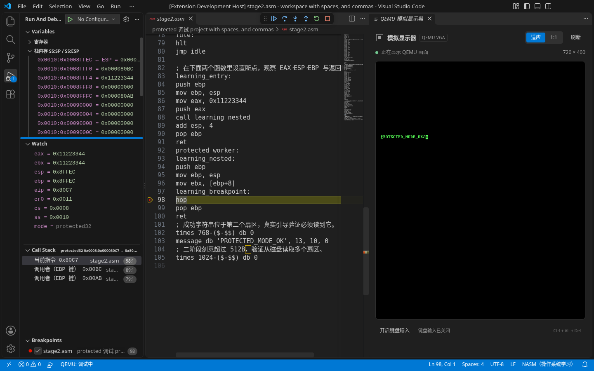

# QEMU Assembly Toolkit

面向操作系统开发的 VS Code 调试与机器状态诊断工具。当前支持 QEMU 上的 x86 引导程序和 32 位 C 内核：从源码断点、调用栈与变量，追踪到寄存器、内存、描述符、页表和客体画面。

[快速开始](docs/QUICKSTART.md) · [配置](docs/CONFIGURATION.md) · [调试指南](docs/DEBUGGING.md) · [常见问题](docs/TROUBLESHOOTING.md) · [全部文档](docs/README.md)



上图来自实际 Linux 调试会话。更多操作见 [8 段按功能录制的视频与 GIF](docs/demos/README.md)。

## 能做什么

| 场景 | 能力 |
| --- | --- |
| NASM 引导程序 | 16/32 位源码断点、单步、寄存器、标志位、BP/EBP 调用链和原始栈 |
| C 内核 | ELF/DWARF 源码断点、源码单步、调用栈、参数、局部变量、结构体、数组和指针 |
| 观察机器状态 | 反汇编、地址/数据断点、虚拟/物理内存、GDT、IDT、IVT、非 PAE 页表 |
| 查看客体画面 | 源码右侧的 QEMU VGA 显示器；可手动开启键盘输入 |
| 选择机器环境 | 为项目保存多套内存、CPU 型号与显示器方案，运行或调试前选择 |
| 接入自己的项目 | `qemu-asm.json` 配置 NASM 构建或已有外部构建命令 |

当前针对单 CPU、x86 16/32 位客体，支持 BIOS raw 软盘及 BIOS El Torito ISO 引导。64 位、PAE、SMP、远程 attach、完整 C++ 调试和语法补全尚未提供。NASM 映射规则、只读能力及两条后端的差异见[调试范围](docs/DEBUGGING.md#支持范围)。

## 安装

1. 使用 VS Code **1.96 或更新版本**。
2. 获取项目交付的 `.vsix` 文件，在 VS Code 扩展视图的 `…` 菜单选择 **从 VSIX 安装**。手上只有源码时，见[开发与打包](docs/DEVELOPMENT.md)。
3. 在**扩展实际运行的宿主**安装对应工具：

| 你要做的事 | 外部工具 |
| --- | --- |
| 构建、运行或调试 NASM 项目 | NASM、`qemu-system-i386` |
| 用已有构建系统运行镜像 | QEMU、项目自己的构建工具 |
| 调试 ELF/DWARF C 源码 | 在上一行基础上增加支持 i386 的 GNU GDB；编译器由项目管理 |

NASM 调试不需要 GDB。安装 VSIX 的用户不需要 Node/npm、Python、FFmpeg 或另一个调试扩展。插件不会自动下载或安装外部工具。

Ubuntu / Debian 的最小 NASM 环境可安装：

```sh
sudo apt-get update
sudo apt-get install nasm qemu-system-x86
```

工具路径可在 `qemuAsm.nasmPath`、`qemuAsm.qemuPath`、`qemuAsm.gdbPath` 中配置。WSL、容器和 SSH 窗口内的工具需安装在对应扩展宿主。具体平台与版本的**实际执行结果**见[兼容性](docs/COMPATIBILITY.md)；配置了 CI 不等于该组合已验证通过。

## 五分钟跑通第一次调试

1. 在 VS Code 打开并信任一个空文件夹。
2. 打开命令面板，执行 **QEMU Assembly: 检查环境**，确认 NASM 和 QEMU 可用。
3. 执行 **QEMU Assembly: 创建引导项目**，选择该目录。已有同名文件会拒绝覆盖。
4. 打开 `boot.asm`，执行 **QEMU Assembly: 开始引导调试**；默认停在 `0x7c00`。
5. 按 F11 单步，在左侧“变量”看寄存器和栈；按 F5 继续，右侧显示器和输出日志应出现 `QEMU_ASM_BOOT_OK`。结束时执行 **QEMU Assembly: 停止**。

看不到这些结果时，按[快速开始](docs/QUICKSTART.md)逐步核对，或查看[常见问题](docs/TROUBLESHOOTING.md)。已有工程可从[真实 OS 工程接入](docs/OS_PROJECT.md)开始，或查看[调试 C 内核](docs/DEBUGGING.md#调试-c-内核)。

已有工程接入示例包括 DreamOS，以及使用 CMake 和高地址分页内核的 [Tilck](docs/TILCK_VALIDATION.md)。两者保留各自的构建与链接布局，使用外部构建、ISO、ELF 符号和源码映射配置。

## 配置

项目根目录的最小 `qemu-asm.json`：

```json
{
  "source": "boot.asm",
  "image": "build/boot.img"
}
```

工具设置、二阶段布局、外部构建、ELF 路径与源码映射的完整示例见[配置参考](docs/CONFIGURATION.md)。默认在运行和调试前构建；`build: false` 明确使用已有产物。外部构建失败会阻止本次启动，工程镜像和 ELF 保留。日志位于 **输出 → QEMU Assembly**，NASM 错误同时出现在“问题”面板。

同一项目需要不同机器环境时，执行 **QEMU Assembly: 配置启动方案** 编辑项目配置，再用 **QEMU Assembly: 选择启动方案** 切换。方案支持内存、CPU 型号和显示器开关，下次启动或重启生效；示例及优先级见[启动方案](docs/CONFIGURATION.md#启动方案)。

## 文档与参与开发

| 你想了解 | 从这里开始 |
| --- | --- |
| 单步、变量、内存、页表和显示器怎么用 | [调试指南](docs/DEBUGGING.md) |
| 工具找不到、断点不命中、显示器无画面 | [常见问题](docs/TROUBLESHOOTING.md) |
| 平台和工具版本到底验证过哪些 | [兼容性](docs/COMPATIBILITY.md) |
| 模块如何划分、依赖如何注入 | [架构图](docs/ARCHITECTURE.md) · [代码结构](docs/STRUCTURE.md) |
| 编译、测试、打包和性能回归 | [开发指南](docs/DEVELOPMENT.md) · [性能](docs/PERFORMANCE.md) |
| 历史交付证据与录屏 | [文档索引](docs/README.md) |

提交问题时请附插件版本、宿主系统、工具版本、复现步骤，以及 **QEMU Assembly: 打开依赖与能力报告** 的相关内容。问题入口：[GitHub Issues](https://github.com/nothingzhl/vscode-qemu-asm/issues)。
