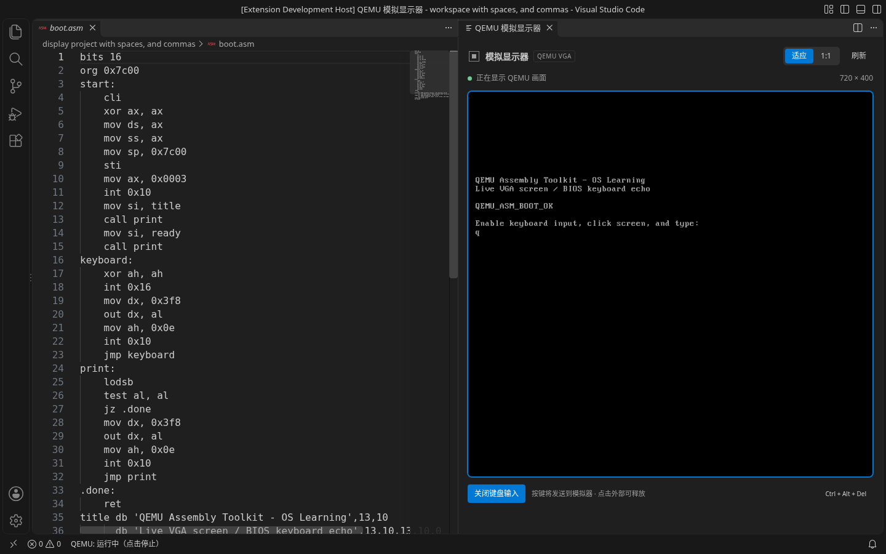

# QEMU Assembly Toolkit

用于 VS Code 1.96+ 的操作系统学习插件。支持创建和构建 x86 NASM 引导项目、QEMU 运行、右侧模拟显示器，以及从 16 位实模式切换到 32 位保护模式的源码调试、寄存器、标志位与栈内存查看。0.3.0 增加二阶段引导学习示例和多文件加载阶段；本轮集成验证结果见[保护模式验证记录](docs/PROTECTED_VALIDATION.md)。暂不提供语法高亮和补全。

## 安装与快速开始

开发环境使用 Node.js 22。Ubuntu / Debian 安装工具：

```sh
sudo apt-get update
sudo apt-get install -y nasm qemu-system-x86
npm ci
npm run check
npm run compile
```

在 VS Code 打开本仓库，按 F5 启动扩展开发宿主。在宿主中打开并信任一个本地文件夹，然后从命令面板依次执行：

1. **QEMU Assembly: 检查环境**：显示 NASM、qemu-system-i386 的路径和版本；缺失时提示配置方法。
2. **QEMU Assembly: 创建引导项目**：选择目录，生成 `boot.asm` 和 `qemu-asm.json`，并保存该工作区的项目位置。学习二阶段加载和保护模式时，改用 **QEMU Assembly: 创建二阶段保护模式项目**，会额外生成 `stage2.asm`。任一目标文件已存在则拒绝覆盖；若中途冲突，仅回滚本次创建的文件。
3. **QEMU Assembly: 构建并运行**：保存文件、停止已有实例、重新构建，再通过 TCG 无界面启动 QEMU。单扇区示例在输出面板出现 `QEMU_ASM_BOOT_OK`，二阶段示例出现 `PROTECTED_MODE_OK`，表示已引导成功。
4. **QEMU Assembly: 停止**：或点击状态栏，停止插件启动的进程。重复运行会先停止上一实例；扩展退出也会清理。

也可单独执行 **QEMU Assembly: 构建**。NASM 错误显示于“问题”面板，可跳转到源码。日志在“输出 → QEMU Assembly”。构建超时为 15 秒；失败会清除旧镜像，运行命令始终重新构建，不运行失败前的产物。

安装分发版本时，可在仓库根目录执行 `npx @vscode/vsce package` 生成 VSIX，然后通过 VS Code 的“扩展：从 VSIX 安装”安装。不自动发布 Marketplace。

## 在 VS Code 中学习与调试

1. 创建引导项目后打开 `boot.asm`，在可执行指令行的左侧点击设置断点（F9）。`.asm` 文件会识别为“NASM（操作系统学习）”；已有其他汇编插件时，可在右下角手动选择该语言模式。
2. 执行 **QEMU Assembly: 开始引导调试**，或在“运行和调试”中选择 **QEMU 16/32 位引导调试**。插件会保存文件、重新构建，并在 BIOS 引导到 `0x7c00` 后暂停。
3. 使用 F5 继续、F10 单步跳过、F11 单步进入、Shift+F11 跳出；可随时暂停。F10 遇到 CALL / INT 会运行到下一条指令，期间用户断点仍然生效。
4. 在“变量 → 寄存器”查看 AX/EAX、SP/ESP、BP/EBP、段寄存器与 EFLAGS，展开 EFLAGS 查看 CF/ZF/IF 等标志位。栈内存按当前代码模式显示 16 位字或 32 位双字；指令地址和栈地址使用 CPU 的实际段缓存。“CPU 模式与地址”显示当前模式、代码/栈指针位数、线性地址和 CR0.PE/PG；寄存器中也可查看 CR0/2/3/4、EFER 及段缓存的 base/limit/flags。
5. “调用堆栈”显示当前指令与可验证的 BP/EBP 调用者链；在“监视”或调试控制台中输入 `AX`、`$eax`、`CS:IP`、`CS:EIP`、`SS:SP`、`SS:ESP`、`mode` 或 `[0x7bfa]`。方括号表达式读取该线性地址的 16 位内存值，`dword[0x8fff0]` 读取 32 位值。当前调试要求关闭分页，因此线性地址就是物理地址。
6. 暂停时寄存器、栈和源码位置会刷新；运行期间先暂停再读取 CPU 状态。调试控制台记录每次停下的段地址、线性地址和源码行。可用调试工具栏重启/停止，也可执行插件的停止命令。

单扇区示例包含 `write_char` 函数及 `push bp / mov bp, sp` 栈帧。在函数内 `push ax` 后打断点，能够观察 SP 下移、AX 入栈以及返回地址；继续经过 `pop` / `ret` 后观察恢复过程。已有项目不会被自动替换。

### 二阶段与保护模式学习流程

1. 在空目录执行 **QEMU Assembly: 创建二阶段保护模式项目**。`boot.asm` 是 BIOS 装入的 512 字节引导扇区，`stage2.asm` 是加载到 `0x8000` 的 1024 字节二阶段程序。
2. 打开两个文件，在 `boot.asm` 的读盘指令附近，以及 `stage2.asm` 的 `mov cr0, eax`、远跳转和 `protected_entry` 后的指令设置断点。开始调试后，F5 可从引导文件继续到二阶段文件。
3. 在 `mov cr0, eax` 处用 F11 观察 `CR0.PE` 置位。此时 CS 的默认指令宽度仍是 16 位；执行 `jmp 0x08:protected_entry` 后才进入 32 位代码。继续经过 `mov ss, ax` 和 `mov esp, 0x90000`，观察段寄存器与栈的变化。
4. 在 `learning_breakpoint` 标签后的 `nop` 指令打断点。此时 EAX/EBX 应为 `0x11223344`，可观察两个 EBP 栈帧、32 位返回地址和传入的参数；用跳出返回上一层，用重启重新从 BIOS 引导。
5. 右侧真实 VGA 显示器和串口日志会输出 `PROTECTED_MODE_OK`。示例直接写入 `0xb8000` 文本显存，进入保护模式后不再依赖 BIOS 显示中断。

示例提供最小 GDT 和 32 位平坦代码/数据段，关闭中断且未设置 IDT 或分页，用于观察启动过程。它不是完整内核模板。


需要保存启动配置时，可手动把以下内容添加到已有 `.vscode/launch.json` 的 `configurations` 数组。插件不会覆盖该文件：

```json
{
  "type": "qemu-asm",
  "request": "launch",
  "name": "操作系统学习：16/32 位引导调试",
  "stopOnEntry": true
}
```

调试使用 QEMU 内置的 GDB Remote Serial Protocol，自动分配仅监听 `127.0.0.1` 的临时端口；**不需要额外安装 GDB 或其他调试插件**。启动、失败、重启及停止会清理本会话创建的 QEMU、连接与临时 listing。

### 当前调试范围

- 单 CPU、NASM `-f bin` 平坦二进制。引导文件要求显式 `BITS 16` 和唯一的 `ORG 0x7c00`；每个加载阶段独立编译，`ORG` 必须等于配置的 `loadAddress`，阶段可显式从 `BITS 16` 或 `BITS 32` 开始。同一文件可用 `BITS 16` / `BITS 32` 切换指令编码，源码位置还会校验实际 CPU 模式。
- 从真实 NASM listing 建立每个文件的指令地址，支持跨加载阶段的源码断点。宏、include、incbin、section 和条件预处理不支持调试映射；不可靠的映射会明确报错。调试中修改源码后须重启，重新构建映射。
- 断点只接受指令行；标签、数据、注释、条件断点与日志断点不支持，不会自动挪到其他行。BIOS、复制到未配置地址的代码及其他未知代码不显示为已知源码。
- 支持标准 16 位实模式、设置 PE 后远跳转前的 16 位过渡状态，以及关闭分页的 32 位保护模式。默认指令宽度取 CS 缓存，栈指针宽度取 SS 缓存；保护模式使用完整 EIP，支持超出 64 KiB 的指令地址，32 位 ESP 不截断为 16 位。
- 调用者支持 16 位 near CALL 的标准 BP 链和 32 位 near CALL 的标准 EBP 链，检查返回地址与 CALL 指令边界。任意手写汇编、无 BP/EBP 栈帧、混用操作数宽度或 far CALL 不保证能还原调用栈；此时仍可查看原始栈内存。跳出需要可验证的调用者。
- 寄存器、标志位和栈为只读；历史调用者没有寄存器快照，须选择当前栈帧查看。调用栈不是 ELF/DWARF 符号展开，也不提供 GDT/IDT 表结构查看。
- 分页（CR0.PG）、虚拟 8086、SMM、unreal mode 和 64 位模式不支持；检测到这些状态时明确结束调试，避免错误解释地址。远程 attach 与完整内核调试仍待后续扩展。

## 右侧模拟显示器

“构建并运行”或“开始引导调试”会自动在源码旁边打开 **QEMU 模拟显示器**。也可执行 **QEMU Assembly: 显示模拟显示器** 随时打开。

- 显示实际 QEMU VGA 画面，支持 BIOS 文字与图形模式，无需另开原生窗口或安装 VNC 客户端。单扇区示例同时向串口和屏幕输出 `QEMU_ASM_BOOT_OK`，二阶段示例输出 `PROTECTED_MODE_OK`；已有源码不会被覆盖。
- 画面约每秒刷新 5 次，截图不会暂停 CPU；在源码断点处暂停后也可继续查看屏幕。
- 可选择等比例“适应”或“1:1”，并手动刷新。停止保留最后一帧；关闭面板不停止 QEMU，重新打开恢复画面。
- 键盘输入默认关闭。点击“开启键盘输入”后，再点击黑色屏幕使其获得焦点，才会转发普通键、方向键、功能键和常见组合键；点击其他位置可释放焦点。支持向客体发送 Ctrl+Alt+Del。
- 当前不转发鼠标、音频或输入法组合文字。刷新频率适合引导程序与操作系统入门实验，不用于高帧率桌面串流。

显示器仅通过本机会话的 QMP 控制接口读取屏幕与发送受限键码，停止、失败、重启及退出会释放连接和临时图像文件。屏幕连接失败会在面板与输出日志提示。



实际截图与验证细节见 [显示器验证记录](docs/DISPLAY_VALIDATION.md)。

## 配置

设置支持按工作区文件夹配置。多工作区时，命令先让用户选择项目所属的工作区。

| 设置 | 默认值 | 说明 |
| --- | --- | --- |
| `qemuAsm.nasmPath` | `nasm` | 可执行文件路径，不含参数或包裹路径的引号 |
| `qemuAsm.qemuPath` | `qemu-system-i386` | 同上；Windows 可填写完整 `.exe` 路径 |
| `qemuAsm.projectDirectory` | `.` | 包含 `qemu-asm.json` 的项目目录 |
| `qemuAsm.qemuArgs` | `[]` | 额外 QEMU 参数，采用选项和值成对的字符串数组 |

项目目录、带分隔符的相对工具路径均相对**所选工作区文件夹**解析；绝对路径原样使用，裸工具名从 PATH 查找。不展开 `~`、环境变量或 `${workspaceFolder}`。Windows 的 `C:tool.exe` 盘符相对路径会被拒绝，请使用 `C:\Tools\tool.exe` 完整路径。工具和项目路径支持空格，启动时使用参数数组，不执行 shell。

`qemu-asm.json` 示例：

```json
{
  "source": "boot.asm",
  "image": "build/boot.img"
}
```

二阶段项目配置：

```json
{
  "source": "boot.asm",
  "image": "build/boot.img",
  "stages": [
    { "source": "stage2.asm", "loadAddress": 32768, "lba": 1 }
  ]
}
```

源码、各阶段源码与镜像路径相对**项目目录**解析。镜像必须在项目内部，不能覆盖任何源码或配置；删除旧产物前会检查实际文件身份，防止大小写别名或目录链接指向源码/配置。输出目录不能通过符号链接跳出项目。

不设置 `stages` 时，产物仍为 512 字节、末尾为 `55 aa` 的引导扇区。配置加载阶段后，构建器独立汇编各源文件，生成 1.44 MB raw 软盘（1474560 字节）镜像：引导扇区位于 LBA 0，各阶段按 `lba` 写入并补零到 512 字节边界。加载阶段最多 8 个；所有补齐后的磁盘范围必须位于 LBA 1..17，合计最多 8704 字节，彼此不得重叠。每段补齐后的内存范围须位于 `0x8000..0x9ffff`，且彼此不重叠。

`loadAddress` 描述源码的预期线性加载地址，构建器不会代替客体读盘。内置 `boot.asm` 只将配置中的首个阶段从 LBA 1 读到 `0x8000`，因此使用内置加载器时首阶段须保持这两个值。构建器向引导文件传入 `STAGE2_SECTORS` 常量，值为首阶段所需扇区数；增加其他阶段或改变位置时，需要自行修改加载器。纯 `BITS 32` 阶段还要求加载器先进入对应的 32 位保护模式，再跳转到该阶段。

额外参数示例：`["-m", "32M", "-cpu", "qemu32", "-smp", "1"]`。当前仅接受 `-m`、`-cpu`、`-smp`，以维持插件对镜像、串口及前台进程生命周期的控制。固定使用 TCG、软盘只读 raw 镜像、无显示、串口 stdout、无网络，不依赖 KVM。

外部工具执行与示例创建均要求 Workspace Trust；只支持文件系统工作区。停止仅针对插件创建的直接子进程；工具配置应指向真正的 NASM/QEMU 可执行文件，若使用包装脚本，应通过 `exec` 转交执行，不能自行后台派生进程。

## 可重复验证

```sh
npm ci
npm run check
npm run compile
npm test
npm run test:integration
npm run test:debug
npm run test:display
npm run test:stage
npm run test:protected
```

`npm test` 覆盖配置解析、空格路径、多工作区基准、不覆盖文件、旧镜像失效、启动失败、超时、取消、符号链接边界、停止与强制终止、异常信号终止、分块 UTF-8 中文日志。额外路径测试使用 Node 的 `path.win32` 和 `path.posix` 验证 Windows 盘符、UNC、空格与中文路径；这些测试不代替原生平台执行。测试直接运行编译后的核心模块，并覆盖 NASM listing、RSP 编码、调试请求与清理竞态；真实 listing 测试需 NASM，否则单独标记跳过。显示器另有 QMP 并发/超时、图像转换及会话清理测试。

集成脚本调用插件共用的项目生成、构建和进程管理代码，在含空格及逗号的临时目录中：

- 实际用 NASM 构建并检查 512 字节与 `55 aa`。
- 实际用 QEMU TCG 无界面引导，15 秒内等待串口标记。
- 停止并确认进程结束，始终清理临时目录和进程。
- 将源码改为错误内容，确认真实 NASM 构建失败且旧镜像不可用。

`npm run test:debug` 验证 QEMU 硬件断点、指令单步、源码映射、寄存器/标志位、BP 调用栈、栈内存、暂停/重启与失败清理；运行时还验证 PE 切换、非零代码段基址、32 位栈，以及分页和 unreal mode 的拒绝。

`npm run test:stage` 验证真实 NASM 的多阶段布局、扇区补零、二阶段错误后的旧镜像失效，并用真实 QEMU 引导二阶段保护模式示例。

`npm run test:protected` 验证多文件断点、实模式到保护模式的单步过渡、32 位寄存器/EBP 调用栈、单步跳过/跳出、重启与进程清理。已执行结果及边界见[保护模式验证记录](docs/PROTECTED_VALIDATION.md)。

`npm run test:display` 实际验证 QEMU 暂停启动、BIOS 文字、QMP 模拟键盘、图形模式红绿像素、运行/暂停截图及清理。宿主测试还检查显示器位于源码右侧、画面更新、关闭重开和与调试单步共存。

可用 `NASM_PATH`、`QEMU_PATH` 环境变量覆盖集成脚本的工具路径。macOS 可先执行 `brew install nasm qemu`；Windows 可通过 Chocolatey 安装 `nasm qemu`，然后在插件设置中填写实际 `.exe` 路径。工具发现与停止行为需要在对应原生平台确认。

真实 VS Code 宿主验证：

```sh
# Linux 先安装 xvfb，然后运行
xvfb-run -a npm run test:host
# Windows / macOS 已有桌面会话时运行
npm run test:host
```

宿主脚本默认通过 `@vscode/test-electron` 下载稳定版 VS Code；可用 `VSCODE_VERSION=1.96.4` 选择最低支持版本，也可用 `VSCODE_EXECUTABLE_PATH` 指向已安装的 VS Code 可执行文件。脚本使用独立临时用户配置，验证真实宿主内的命令注册、信任限制、多工作区资源设置、真实 NASM/QEMU 构建运行停止、串口标记和错误 diagnostics，以及完整的 VS Code 调试会话（断点、单步、寄存器、堆栈、重启和清理）、真实显示器面板，以及二阶段保护模式调试。

CI 矩阵覆盖 Ubuntu、macOS、Windows，以及 VS Code 1.96.4 / stable；每组安装真实 NASM/QEMU，运行核心测试、集成与宿主测试。远端结果须以实际 Actions 检查为准。当前已执行的验证、平台限制及人工交互待验收项见 [验证记录](docs/VALIDATION.md)。
