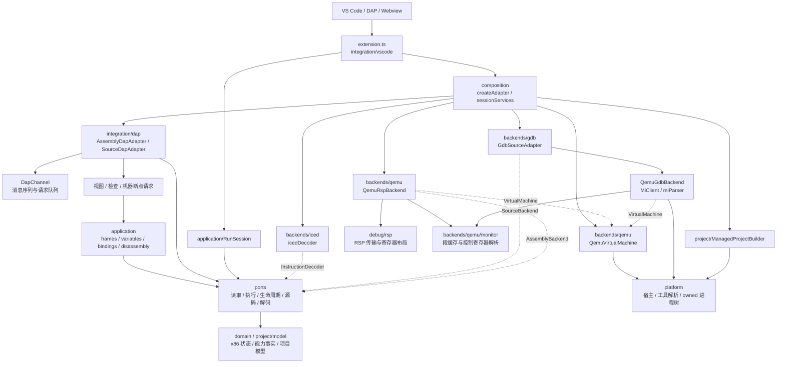
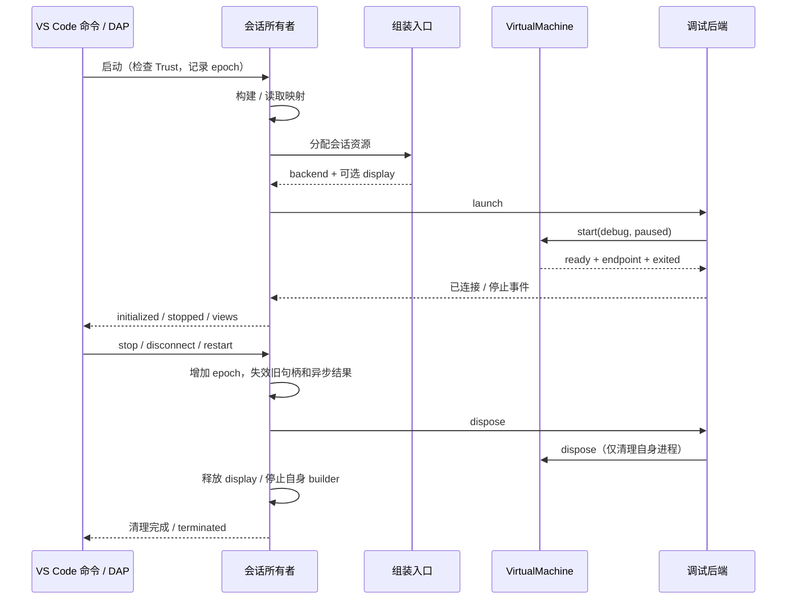

# 插件架构

本文描述当前代码中的实际边界。目标是按使用场景组合小能力，隔离第三方协议，明确每次会话的资源归属。替换实现发生在组装时；当前没有动态插件注册或运行中热插拔机制。

本次执行结果见 [架构重构验证](ARCHITECTURE_VALIDATION.md)。

## 从哪里开始阅读

1. [extension.ts](../src/extension.ts)：VS Code 激活、命令注册、Workspace Trust 和扩展级服务。
2. [createAdapter.ts](../src/composition/createAdapter.ts) 与 [sessionServices.ts](../src/composition/sessionServices.ts)：选择并组合 DAP 接入、构建器、后端和虚拟机。
3. [ports](../src/ports)：消费者需要的能力及数据契约；先看 machine、source、virtualMachine、instructions。
4. [integration/dap](../src/integration/dap)：DAP 消息与功能请求；[application](../src/application) 管理变量句柄、断点绑定、运行流程和反汇编。
5. [backends](../src/backends)：QEMU、GDB/MI、iced-x86 的真实实现。

## 模块与依赖方向

箭头表示代码依赖或显式注入，不表示共享可变状态。点线表示通过能力契约调用。

`ports` 和 `domain` 不导入具体后端或 VS Code API；`application` 和 DAP 功能不导入 MI、RSP 后端或 iced-x86。边界测试检查这些方向，防止后续功能绕过接口拼接原始工具命令。

`project` 管理配置、构建、诊断和安全创建。QEMU 参数生成留在 `backends/qemu/arguments.ts`，没有混入项目通用逻辑。显示控制和观察器仍保留在 `display`、`inspector`，由 VS Code 集成入口连接；这次没有重写 Webview 协议或增加新的显示后端。

## 小能力如何组合

| 使用场景 | 接收的能力 | 实现与语义 |
| --- | --- | --- |
| 读取 CPU / 内存 | `RegisterReader`、`MemoryReader` | NASM 经 RSP，C 经 GDB/MI；都校验 QEMU 段缓存 |
| 页表遍历 | `RegisterReader`、`PhysicalMemoryReader` | 物理读取单独定义，不能冒充普通线性读取 |
| 运行客体 | `VirtualMachine` | QEMU 实现拥有进程、启动参数和调试端点 |
| C 栈、变量、断点 | `SourceStackReader`、`SourceVariableReader`、`SourceBreakpointCommands` | GDB Adapter 将 MI 转换成帧、变量、绑定和停止事件 |
| 反汇编 | `InstructionDecoder` + 读取能力 | iced 实现延迟加载 WASM；业务流程不引用库对象 |
| 构建 | `ProjectBuilder` | ManagedProjectBuilder 拥有自己的 Processes |
| 会话画面 | `DebugDisplay` | 会话只连接和释放；QEMU 附加参数只在组装边界出现 |

`AssemblyBackend` 与 `SourceBackend` 是**当前会话所需的小能力组合**，不是要求所有未来实现提供的万能基础接口。`SourceValues` 只接收栈、变量和读取能力，断点绑定只接收断点命令；新增能力不应默认加进这两个组合。

例如增加另一种源码后端：实现业务能力，返回 `SourceFrame`、`SourceVariable`、`SourceBinding` 和 `SourceStoppedEvent`，然后调整组装入口。无需让变量视图认识该后端的命令或返回格式。能否支持当前完整 C 会话仍需逐项验证，不能仅因实现了 TypeScript 接口就宣布兼容。

## 两条调试路径

- NASM：构建 listing → SourceMaps → RSP 后端 → QEMU。源码位置要验证客体中的真实字节与分页映射；调用者来自可验证的 BP/EBP 链。
- C：构建 ELF/DWARF → GdbSourceAdapter → GDB/MI 后端 → QEMU。调用栈由 GDB 展开，变量由 varobj 管理；源码步进与指令步进保留区别。

C 上层不再调用 `mi(command)`，也不解析 `MiTuple`。入口数值到 `*address` 的转换、ELF 默认入口、硬件断点与监视点命令、变量列表和 MI 停止原因都在 GDB 实现侧转换。私有 `GdbConnection` 仅用于后端内组合与兼容测试入口。

RSP 和 GDB 后端各自处理停止顺序、硬件断点跨越和监视点语义。物理模式切换分别保持各自传输事务；恢复失败关闭会话，不能继续在未知地址空间中读取。

## 资源归属与生命周期

- DAP 会话拥有自己的后端、显示句柄、构建器、映射、断点和缓存。扩展级输出、诊断、显示控制器与报告文档不由单次后端占有。
- `DapChannel` 串行化请求和停止处理；epoch 防止旧启动结果写进新会话。停止时先使状态失效，再释放资源。
- `SourceValues` 每次停止生成新句柄，继续/重启时清除句柄并删除根 varobj；不会把过期 frame ID 解释为新的当前帧。
- `RunSession` 独立拥有无需调试的 VM 和显示资源。停止等待尚未结束的资源分配；退出、失败与显式停止共用一次清理。
- `QemuVirtualMachine` 单次启动；`Processes` / MI client 负责自己的在途启动和进程树。GDB 后端取消启动后等待已创建的 GDB 清理。
- 能力事实绑定会话、宿主、工具和机器配置。unknown、supported、unsupported 及证据范围保留；可选解码/显示失败不伪造成核心后端通过。

## 文件粒度与 review 顺序

新增模块围绕独立状态或真实依赖边界拆分：帧读取、变量句柄、断点绑定、MI 解析、MI 传输、物理内存事务、解码器、QEMU 生命周期分别 review。文件短不依靠压行，也不要求一个接口只能对应一个类。

这次保留以下较大文件作为明确例外：

| 文件 | 保留原因 / review 重点 |
| --- | --- |
| `integration/dap/assemblyAdapter.ts` | NASM 会话协调：listing、启动、暂停、临时断点与单步要共享一致的 epoch 和状态；视图、解码和机器断点请求已独立 |
| `integration/dap/sourceAdapter.ts` | C 会话协调与运行时更新源码断点；变量对象和绑定集合已由独立对象管理 |
| `backends/qemu/rspBackend.ts` | RSP 停止状态机、跨断点单步和暂停竞态；事务内存、断点替换、XML 传输及停止包解析已拆开 |
| `backends/gdb/qemuBackend.ts` | MI 启动/取消、串行停止、同值写监视点恢复；源码转换、内存、MI transport/parser 已拆开 |
| `extension.ts` | VS Code 注册与扩展级服务组装；配置、依赖报告、会话显示资源已拆开 |

这些文件是继续缩小的候选，不是放宽后续功能的默认容器。新增功能优先进入独立能力与功能模块，不能继续往状态机或公共接口堆方法。存量 `debug/rsp.ts`、`debug/inspection.ts`、`inspector/model.ts` 等仍有独立的协议/模型内容，本次没有为凑行数重排全部存量文件。

建议按提交顺序 review：领域与 VM 边界 → 真实消费者与源码能力 → 验证和架构说明。先看契约及资源所有者，再看实现和失败路径，最后核对真实验证。

## 兼容入口与扩展限制

`core.ts`、`debug/adapter.ts`、`debug/cAdapter.ts`、`debug/runtime.ts`、`debug/gdbRuntime.ts`、`debug/mi.ts` 和 `debug/disassembly.ts` 保留旧独立集成脚本使用的入口。生产会话从组装入口和具体能力模块导入，不经这些兼容构造器偷偷创建后端。

当前仍仅实现 QEMU VM、NASM/RSP、C/GDB MI、iced-x86 和 QMP 共享文件截图。接口分离不等于已经支持其他虚拟机、LLDB、跨宿主画面、热插拔、64 位或 SMP；需要各自的实现和真实平台验收。
