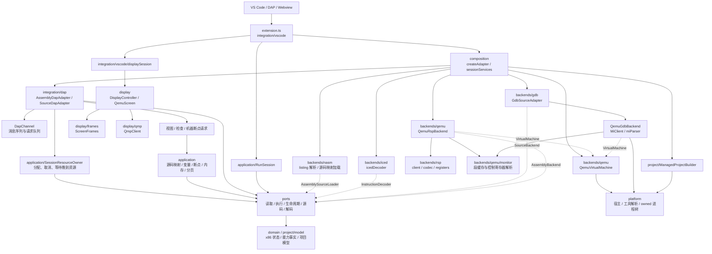
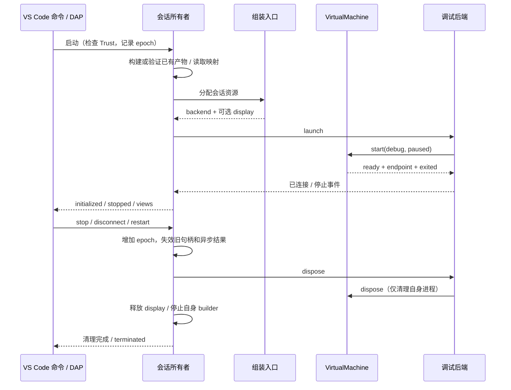

# 插件架构

本文描述当前代码中的实际边界。目标是按使用场景组合小能力，隔离第三方协议，明确每次会话的资源归属。替换实现发生在组装时；当前没有动态插件注册或运行中热插拔机制。

本文与[代码结构清单](STRUCTURE.md)描述当前架构；工具组合与性能的实际范围分别见[兼容性](COMPATIBILITY.md)和[性能](PERFORMANCE.md)。[首轮验证](ARCHITECTURE_VALIDATION.md)、[第二轮重构验证](ARCHITECTURE_REFINEMENT.md)保留当时的历史环境与结果，不作为当前完整验收。

## 从哪里开始阅读

1. [extension.ts](../src/extension.ts)：VS Code 激活、命令注册、Workspace Trust 和扩展级服务。
2. [createAdapter.ts](../src/composition/createAdapter.ts) 与 [sessionServices.ts](../src/composition/sessionServices.ts)：选择并组合 DAP 接入、构建器、后端和虚拟机。
3. [ports](../src/ports)：消费者需要的能力及数据契约；先看 machine、source、virtualMachine、instructions。
4. [integration/dap](../src/integration/dap)：DAP 消息与功能请求；[application](../src/application) 管理变量句柄、断点绑定、运行流程和反汇编。
5. [backends](../src/backends)：QEMU、GDB/MI、iced-x86 的真实实现。

## 模块与依赖方向

箭头表示代码依赖或显式注入，不表示共享可变状态。点线表示通过能力契约调用。

`ports` 和 `domain` 不导入具体后端或 VS Code API；`application` 和 DAP 功能不导入具体后端或兼容入口。NASM listing、RSP 编码和 MI 转换分别归属 `backends/nasm`、`backends/rsp`、`backends/gdb`。边界测试检查这些方向，防止后续功能绕过接口拼接原始工具命令。

`project` 管理配置、构建、诊断和安全创建。 `project/model.ts` 分离构建方式、`boot` 引导介质和 `debug` 符号配置；`project/artifact.ts` 执行外部构建或复用已有产物，并校验文件归属，`project/iso.ts` 校验 ISO9660 / BIOS El Torito 元数据。QEMU 参数生成留在 `backends/qemu/arguments.ts`，没有混入项目通用逻辑。显示控制和观察器仍保留在 `display`、`inspector`，由 VS Code 集成入口连接；VS Code 观察器注册、示例创建及构建诊断分别由 `integration/vscode` 的功能模块负责。`inspector/model.ts` 管理刷新状态；`snapshots.ts` 读取与提交快照；`validation.ts` 校验响应，`types.ts` 定义视图数据。只有确认响应属于当前暂停后才更新内存差异历史。

`application/source/values.ts` 拥有 C 栈帧和变量句柄；[machineValues.ts](../src/application/source/machineValues.ts)单独读取当前 CPU 的寄存器、模式和原始栈，避免把这些状态解释成历史调用帧的数据。[display/frames.ts](../src/display/frames.ts)负责有界图像校验、PNG 编码和单帧复用，不承担 QMP 连接或面板生命周期。

## 小能力如何组合

| 使用场景 | 接收的能力 | 实现与语义 |
| --- | --- | --- |
| 读取 CPU / 内存 | `RegisterReader`、`MemoryReader` | NASM 经 RSP，C 经 GDB/MI；都校验 QEMU 段缓存 |
| 页表遍历 | `RegisterReader`、`PhysicalMemoryReader` | 物理读取单独定义，不能冒充普通线性读取 |
| 运行客体 | `VirtualMachine` | QEMU 实现拥有进程、启动参数和调试端点 |
| C 栈、变量、断点 | `SourceStackReader`、`SourceVariableReader`、`SourceBreakpointCommands` | GDB Adapter 将 MI 转换成帧、变量、绑定和停止事件 |
| 反汇编 | `InstructionDecoder` + 读取能力 | iced 实现延迟加载 WASM；业务流程不引用库对象 |
| 构建与产物准备 | `ProjectBuilder` | ManagedProjectBuilder 拥有 Processes；内置 NASM 管理自身输出，外部/已有镜像由项目拥有 |
| 汇编源码映射 | `AssemblySourceLoader` | 组装入口选择 NASM 实现；临时 listing 的构建、解析和删除都在实现内完成 |
| 会话画面 | `DebugDisplay` | 会话只连接和释放；QEMU 附加参数只在组装边界出现 |

`AssemblyBackend` 与 `SourceBackend` 是**当前会话所需的小能力组合**，不是要求所有未来实现提供的万能基础接口。`SourceValues` 只接收栈、变量和读取能力，断点绑定只接收断点命令；`AssemblySourceLoader` 只加入汇编会话选项，不要求 C 后端实现它；新增能力不应默认加进这两个组合。

例如增加另一种源码后端：实现业务能力，返回 `SourceFrame`、`SourceVariable`、`SourceBinding` 和 `SourceStoppedEvent`，然后调整组装入口。无需让变量视图认识该后端的命令或返回格式。能否支持当前完整 C 会话仍需逐项验证，不能仅因实现了 TypeScript 接口就宣布兼容。

## 两条调试路径

- NASM：构建 listing → SourceMaps → RSP 后端 → QEMU。源码位置要验证客体中的真实字节与分页映射；调用者来自可验证的 BP/EBP 链。
- C：构建或验证已有镜像及 ELF/DWARF → GdbSourceAdapter → GDB/MI 后端 → QEMU。调用栈由 GDB 展开，变量由 varobj 管理；源码步进与指令步进保留区别。

C 上层不再调用 `mi(command)`，也不解析 `MiTuple`。入口数值到 `*address` 的转换、ELF 默认入口、硬件断点与监视点命令、变量列表和 MI 停止原因都在 GDB 实现侧转换。私有 `GdbConnection` 仅用于后端内组合与兼容测试入口。

RSP 和 GDB 后端各自处理停止顺序、硬件断点跨越和监视点语义。物理模式切换分别保持各自传输事务；恢复失败关闭会话，不能继续在未知地址空间中读取。

## 资源归属与生命周期

- DAP 会话通过 `SessionResourceOwner` 拥有后端及显示资源，另外拥有自己的构建器、映射、断点和缓存。资源分配期间停止，会等待晚到的分配结果并清理；晚到资源的清理错误向释放调用方报告，在途的重复释放共享同一结果。信任检查或能力观察失败也释放完整资源对。扩展级输出、诊断、显示控制器与报告文档不由单次后端占有。
- `DapChannel` 串行化请求和停止处理；epoch 防止旧启动结果写进新会话。启动、重启或配置完成失败后走同一清理路径；清理异常会输出诊断，不让队列一直处于拒绝状态而阻断后续请求。停止时先使状态失效，再释放资源。
- `SourceValues` 在同一暂停代际合并重复栈帧与变量读取，失败后允许重试。继续/重启时增加 revision，失效在途结果、句柄和缓存并删除根 varobj；迟到创建的 varobj 单独释放，不把过期 frame ID 解释为新的当前帧。变量缓存最多保留 128 项且合计不超过 4096 个变量，根 varobj 上限 512，变量句柄上限 4096，避免遍历大数组时无限累积。
- `ScreenFrames` 仅保留最近一帧 PNG 和对应 PPM 摘要，不保留原始截图。相同内容复用 PNG，面板跳过重复 base64 和 Webview 消息；显式刷新与重开面板可重发最后画面。截图串行队列不保留已完成帧，释放会等待在途截图、清空缓存并删除临时目录。变化画面的摘要 CPU 代价见[性能测量](PERFORMANCE.md)，不将局部优化宣称为整体内存下降。
- `releaseAll` 等待所有清理动作完成后再报告首个错误，避免一个资源释放失败导致调用方提前返回、另一资源还在清理。DAP 会话无论自然退出、显式停止还是失败，都在清理完成后通过 `finally` 发出 `terminated`；释放后端出错仍会尝试释放构建器。
- `RunSession` 独立拥有无需调试的 VM 和显示资源。停止等待尚未结束的资源分配；退出、失败与显式停止共用一次清理；并发停止等待同一结果，晚到资源的清理失败向启动和停止双方传播，正常取消与工厂失败分别处理。
- `QemuVirtualMachine` 单次启动；`Processes` / MI client 负责自己的在途启动和进程树。GDB 后端取消启动后等待已创建的 GDB 清理。
- 外部构建失败、超时或取消直接拒绝本次启动，不删除工程拥有的镜像或 ELF；`build: false` 仅验证已有文件，不判断新鲜度。QEMU 只读打开所选软盘/ISO，固件与客体引导器负责加载内核；符号后端不执行 GDB `load`。
- 能力事实绑定会话、宿主、工具和机器配置。unknown、supported、unsupported 及证据范围保留；可选解码/显示失败不伪造成核心后端通过。

## 文件粒度与 review 顺序

新增模块围绕独立状态或真实依赖边界拆分：帧读取、变量句柄、断点绑定、MI 解析、MI 传输、物理内存事务、解码器、QEMU 生命周期分别 review。文件短不依靠压行，也不要求一个接口只能对应一个类。

当前有 4 个生产文件超过 250 行，其余均在 250 行以内。以下状态机保留明确例外，测试中的预算只用于防止无声增长，不代表建议写满预算：

| 文件 | 当前行数 / 预算 | 保留原因与已拆职责 |
| --- | --- | --- |
| `integration/dap/assemblyAdapter.ts` | 453 / 460 | 保留启动、暂停、临时断点和 epoch 的协调；listing 加载、源码验证、F10 规划、断点请求和资源归属已拆出 |
| `integration/dap/sourceAdapter.ts` | 425 / 430 | 保留 C 启动、源码断点更新期间的暂停/恢复与停止事件顺序；请求验证、变量句柄、绑定与资源归属独立 |
| `backends/qemu/rspBackend.ts` | 379 / 380 | 保留跨硬件断点单步与停止状态机；协议传输/编码/寄存器布局、断点替换、物理内存事务分别独立 |
| `backends/gdb/qemuBackend.ts` | 359 / 365 | 保留 MI 启动取消、停止事件和同值写监视点恢复；配置、寄存器、内存、源码转换和 MI transport/parser 已拆开 |

没有把这些状态机再拆成依赖大量私有字段的上下文对象或继承层。它们不作为后续功能的默认容器；新能力仍按独立契约、实现、组装和消费者接入。架构测试同时禁止业务层导入 `debug/` 或 `core.ts` 兼容入口，以及领域/契约反向依赖应用或编辑器层。

建议按提交顺序 review：领域与 VM 边界 → 真实消费者与源码能力 → 验证和架构说明。先看契约及资源所有者，再看实现和失败路径，最后核对真实验证。

## 兼容入口与扩展限制

`core.ts`、`debug/adapter.ts`、`debug/cAdapter.ts`、`debug/runtime.ts`、`debug/gdbRuntime.ts`、`debug/mi.ts` 和 `debug/disassembly.ts` 保留旧独立集成脚本使用的入口。`debug/` 现在全部为兼容入口；其余源码不导入该目录。生产会话从组装入口和实际职责模块导入，旧独立脚本仍可使用原有导出。

当前仍仅实现 QEMU VM、NASM/RSP、C/GDB MI、iced-x86 和 QMP 共享文件截图。接口分离不等于已经支持其他虚拟机、LLDB、跨宿主画面、热插拔、64 位或 SMP；需要各自的实现和真实平台验收。
