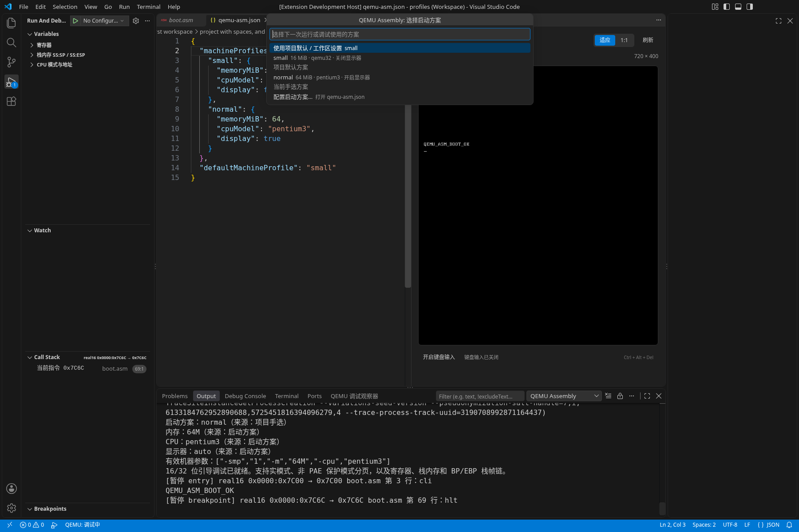

# 配置参考

VS Code 设置负责工具、工作区位置及机器默认值；项目内的 `qemu-asm.json` 负责构建方式、引导介质、调试符号与可选的启动方案。首次使用可先按[快速开始](QUICKSTART.md)生成最小项目。

## VS Code 设置

设置可按工作区文件夹保存。多工作区下，命令会先选择项目所属的工作区。

| 设置 | 默认值 | 说明 |
| --- | --- | --- |
| `qemuAsm.nasmPath` | `nasm` | NASM 可执行文件；外部构建无需插件内置 NASM |
| `qemuAsm.qemuPath` | `qemu-system-i386` | QEMU 可执行文件 |
| `qemuAsm.gdbPath` | `gdb` | 仅 C/ELF 源码调试需要的 GDB |
| `qemuAsm.projectDirectory` | `.` | 包含 `qemu-asm.json` 的项目目录 |
| `qemuAsm.displayMode` | `auto` | `auto` 创建模拟显示器；`off` 不分配 QMP 显示资源 |
| `qemuAsm.qemuArgs` | `[]` | 仅接受 `-m`、`-cpu`、`-smp` 的选项/值对 |

例如工作区 `.vscode/settings.json`：

```json
{
  "qemuAsm.projectDirectory": "kernel",
  "qemuAsm.qemuPath": "/opt/qemu/bin/qemu-system-i386",
  "qemuAsm.qemuArgs": ["-m", "32M", "-cpu", "qemu32", "-smp", "1"],
  "qemuAsm.displayMode": "auto"
}
```

`projectDirectory` 和设置里带分隔符的相对工具路径以**所选工作区文件夹**为基准；绝对路径直接使用，裸工具名从 PATH 查找。工具路径只填写可执行文件，不包含参数或外层引号。不展开 `~`、环境变量或 `${workspaceFolder}`。Windows 请用 `C:\Tools\qemu-system-i386.exe` 这样的完整路径，不能用 `C:tool.exe` 盘符相对路径；在 JSON 中反斜杠须写为 `\\`。

工具运行于扩展宿主。WSL、容器或 SSH 窗口内的 PATH 和文件系统与本地窗口不同，详见[环境排错](TROUBLESHOOTING.md#工具找不到或路径不对)。

## 启动方案

同一项目可以保存多套机器配置，供运行和调试共用。执行 **QEMU Assembly: 配置启动方案**，会打开真实项目的 `qemu-asm.json`；编辑器通过 JSON Schema 提供字段说明、补全和错误提示。当前使用 JSON 编辑器，尚无独立的图形配置页面。

在已有项目配置中加入以下字段，例如：

```json
{
  "source": "boot.asm",
  "image": "build/boot.img",
  "defaultMachineProfile": "normal",
  "machineProfiles": {
    "normal": {
      "memoryMiB": 64,
      "cpuModel": "qemu32",
      "display": true
    },
    "low-memory": {
      "memoryMiB": 16,
      "display": false
    }
  }
}
```

| 字段 | 含义与约束 |
| --- | --- |
| `machineProfiles` | 名称到启动方案的映射；名称为 1..64 字符，不含首尾空白或控制字符；每套方案可只填写需要覆盖的字段 |
| `defaultMachineProfile` | 项目默认方案名称，必须指向已定义方案 |
| `memoryMiB` | 客体内存，单位 MiB；整数，范围 1..4096 |
| `cpuModel` | 单个 CPU 型号，例如 `qemu32`；不接受附带特性或其他 QEMU 参数 |
| `display` | `true` 开启内嵌显示器，`false` 不分配 QMP 显示资源 |

执行 **QEMU Assembly: 选择启动方案**，从当前项目的方案中选择。插件按工作区文件夹与项目根目录分别记住手选结果，不修改其他项目。选中的方案在**下次启动或重启**时生效，不会修改正在运行的虚拟机。

下图来自真实调试会话：当前手选 `normal`，客体使用 64 MiB、`pentium3` 与内嵌显示器；列表同时标明项目默认方案。输出面板显示本次启动的实际配置。



完整配置界面与验证范围见[启动方案验收](MACHINE_PROFILES_VALIDATION.md)。

要取消手选，在列表中选择“使用项目默认 / 工作区设置”；随后使用项目默认方案，没有默认方案时继承工作区设置。方案中未知字段会报错，避免拼写错误被忽略。

选择顺序为：**`launch.json` 的 `machineProfile` → 记住的手选方案 → `defaultMachineProfile` → 原有设置**。显式指定或记住的方案不存在时会报错，不会悄悄使用另一套机器环境。

方案内未填写的字段继承现有设置：内存与 CPU 继承 `qemuAsm.qemuArgs`，显示器继承 `qemuAsm.displayMode`；没有相应设置时沿用现有 QEMU 默认值。方案只覆盖对应项，启动参数不会因此重复添加 `-m` 或 `-cpu`。没有新增项目字段的旧项目仍沿用原有行为，`qemuAsm.qemuArgs` 保留。

CPU 型号由实际选中的 QEMU 查询并校验，工具版本间可能不同；型号存在不代表它支持任意客体所需的指令。当前仍是单 CPU 的 x86 16/32 位环境，不开放磁盘、网络、UEFI、多核或硬件加速方案。

**输出 → QEMU Assembly** 与 **QEMU Assembly: 打开依赖与能力报告** 会显示当前方案、选择来源及内存、CPU、显示器的生效配置。排查配置未生效时，先确认报告对应本次启动，再核对是否被 `launch.json` 显式指定的方案覆盖。

## 单扇区 NASM 项目

项目根目录的 `qemu-asm.json`：

```json
{
  "source": "boot.asm",
  "image": "build/boot.img"
}
```

`source`、`image` 相对项目目录解析。内置 NASM 构建使用 `-f bin`，单扇区产物要求恰好 512 字节，结尾为 `55 aa`。源码映射要求显式 `BITS 16` 和唯一的 `ORG 0x7c00`，其他限制见[调试范围](DEBUGGING.md#支持范围)。

镜像必须在项目内，不可覆盖源码或配置。构建器检查实际文件身份和目录链接，防止别名覆盖；输出目录不能通过符号链接跳出项目。构建失败、取消或超时后不会运行旧镜像。

## 二阶段 NASM 项目

```json
{
  "source": "boot.asm",
  "image": "build/boot.img",
  "stages": [
    { "source": "stage2.asm", "loadAddress": 32768, "lba": 1 }
  ]
}
```

构建器独立汇编每个源文件，生成 1.44 MB raw 软盘镜像。引导扇区在 LBA 0，各阶段按 `lba` 写入并补零到 512 字节边界。

- 最多 8 个阶段；补齐后的磁盘范围必须位于 LBA 1..17，合计最多 8704 字节且不重叠。
- 每阶段 `loadAddress` 必须与其 `ORG` 一致；补齐后的内存范围位于 `0x8000..0x9ffff`，彼此不重叠。
- `loadAddress` 描述预期加载地址，**不会代替客体读盘**。内置引导程序只把首阶段从 LBA 1 加载到 `0x8000`，使用该加载器时保留这两个值。
- 构建器向引导文件传入首阶段扇区数 `STAGE2_SECTORS`。增加阶段或改变布局时，需自行修改加载器；纯 `BITS 32` 阶段要求加载器先进入相应保护模式。

已有多阶段工程无需采用内置模板，但必须满足磁盘布局和源码映射边界。

## 外部构建与 C 源码调试

项目可沿用自己的编译器、链接器和加载器：

```json
{
  "image": "build/os.iso",
  "boot": { "type": "iso" },
  "build": {
    "command": "make",
    "args": ["debug"],
    "cwd": ".",
    "timeout": 120000
  },
  "debug": {
    "elf": "build/kernel.elf",
    "gdbPath": "gdb",
    "entry": "kernel_main",
    "sourceMap": { "/original/build": "." }
  }
}
```

| 字段 | 规则 |
| --- | --- |
| `boot.type` | `floppy`（默认）或 `iso`；ISO 使用 BIOS El Torito 光盘引导 |
| `build` | 命令对象表示构建后启动；`false` 表示直接使用已有产物；省略时保持内置 NASM 构建 |
| `build.command` | 单个可执行文件，不解释 shell 语法；裸命令查 PATH，带路径时相对项目根解析 |
| `build.args` | 参数数组，默认 `[]`，最多 256 项 |
| `build.cwd` | 默认项目目录；实际目录必须在项目内，不能通过链接跳出 |
| `build.timeout` | 毫秒，默认 120000，范围 100..1800000 |
| `debug.elf` | 符号文件路径，相对项目根；要求带 DWARF 的小端 i386 ELF32 `ET_EXEC` |
| `debug.gdbPath` | 项目级 GDB，覆盖 `qemuAsm.gdbPath`；带路径时相对项目根 |
| `debug.entry` | 函数符号或 32 位 `0x` 地址；省略时使用 ELF 入口 |
| `debug.sourceMap` | 构建时源码目录到当前目录的映射；目标目录相对项目根 |

仅需外部构建并运行时，可省略 `debug`。外部构建或已有产物模式不能同时配置 NASM `stages`，也不会额外调用 NASM。ISO 要求显式配置外部构建或 `build: false`，内置 NASM 构建只生成软盘镜像。

镜像必须是项目内普通文件，不能与 ELF、配置或已声明源码指向同一文件；目录不能通过符号链接跳出项目。

- `floppy`：512..1474560 字节、按 512 字节对齐，首扇区末尾为 `55 aa`。
- `iso`：按 2048 字节对齐，包含 ISO9660 卷描述符和有效的默认 BIOS x86 El Torito 引导项；仅 UEFI 的 ISO 不支持。不再应用软盘容量和首扇区签名规则。

外部构建产物由工程管理，插件不预先删除镜像、ELF 或其他产物。构建失败、超时或取消会阻止本次启动，即使磁盘上仍有旧镜像。构建成功后再检查镜像；插件不通过时间戳推断产物是否更新，构建系统负责让镜像与符号匹配。

### 使用已有产物

先在项目自己的环境完成构建，再明确选择：

```json
{
  "image": "build/os.iso",
  "boot": { "type": "iso" },
  "build": false,
  "debug": {
    "elf": "build/kernel.elf",
    "entry": "kernel_main"
  }
}
```

此模式的构建、运行、调试及重启都只验证并使用已有文件，不执行编译，也不要求 NASM 或构建器；修改源码后必须自行重建。只运行镜像可省略 `debug`；外部构建、已有产物和 ISO 项目若要源码调试，必须配置 `debug.elf`。

项目的 BIOS 引导器（例如 ISO 内的 GRUB）负责装载内核到 ELF 链接地址，插件不实现 Multiboot 加载器，也不执行 GDB `load`。ELF64、PIE/ET_DYN、未链接目标文件和缺失调试节的 ELF 会被拒绝。硬盘、`-kernel`、UEFI 和远程 attach 尚未提供。

## 保存调试启动项

直接执行开始调试命令即可，无需创建 `launch.json`。需要保存启动项时，把以下内容加入已有 `.vscode/launch.json` 的 `configurations` 数组；插件不会覆盖该文件：

```json
{
  "type": "qemu-asm",
  "request": "launch",
  "name": "OS 开发：32 位内核调试",
  "machineProfile": "normal",
  "stopOnEntry": true
}
```

NASM 默认停在 `0x7c00`；C 项目停在配置入口或 ELF 入口。设为 `false` 时继续运行，用户断点仍然生效。

`machineProfile` 可选；示例中的 `normal` 必须已在项目内定义。不指定时使用手选或项目默认方案。重启会重读项目配置：显式指定的方案保持同一名称并读取新值；未显式指定时重新解析当前手选或默认方案。

## 进程和执行边界

外部工具执行与项目创建要求 Workspace Trust，且只支持文件系统工作区。参数按数组传递，不经 shell；Windows `.cmd/.bat` 构建脚本须显式配置解释器和参数。

QEMU 固定使用 TCG、串口 stdout 和无网络配置；按 `boot.type` 使用只读 raw 软盘或 ISO 光盘，不依赖 KVM；画面通过 QMP 显示。额外参数只允许内存、CPU 类型和 CPU 数量，调试要求单 CPU。构建命令不应自行脱离进程组或启动长期后台服务。停止、失败、取消和退出只清理插件拥有的资源；原生平台执行范围见[兼容性](COMPATIBILITY.md)。
