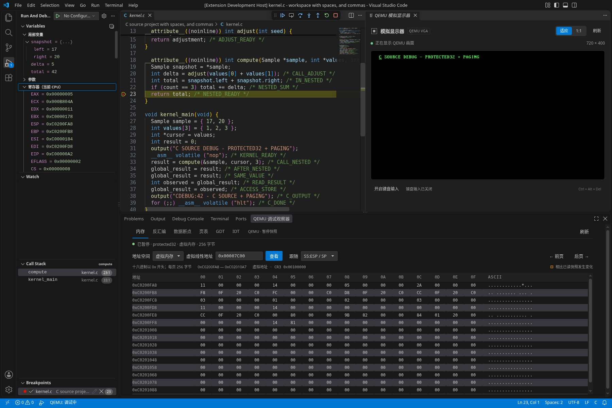

# 0.7.0 C 源码调试

日期：2026-10-15。实际环境：Linux x86_64 / Debian 13、Node.js 22.23.3、GCC 14.2.0、GNU binutils、GDB 16.3、NASM 2.16.03、QEMU 10.0.13 TCG。真实宿主为官方 VS Code 1.96.4 和 1.142.0，使用 Xvfb。

本轮将已有 C 内核接入源码调试：外部命令构建镜像和 ELF，插件管理 QEMU/GDB，在 VS Code 使用 C 行断点、源码单步、DWARF 调用栈、参数、局部变量、结构体、数组和指针。NASM 项目继续使用原有直接 RSP 后端，不依赖 GDB。所有 C 客体代码只在测试临时目录生成，没有增加面向用户的教学模板。

## 接入已有项目

在项目的 `qemu-asm.json` 中配置：

```json
{
  "image": "build/os.img",
  "build": {
    "command": "make",
    "args": ["debug"],
    "cwd": ".",
    "timeout": 120000
  },
  "debug": {
    "elf": "build/kernel.elf",
    "gdbPath": "gdb",
    "entry": "kernel_main",
    "sourceMap": { "/original/build": "." }
  }
}
```

`build.command` 为可执行文件，参数通过数组传入，不解释 shell 语法。省略 `args`、`cwd`、`timeout` 时分别使用空数组、项目目录、120000 毫秒；超时范围为 100..1800000 毫秒。`cwd` 必须在项目内，实际目录也不能通过链接跳出。带路径的构建命令、项目 `debug.gdbPath`、ELF 与源码映射替换目录相对项目根解析；裸工具名从 PATH 查找。设置中的 `qemuAsm.gdbPath` 则相对所选工作区解析。

外部构建不能同时配置 NASM `stages`。镜像必须是项目内的普通文件，512..1474560 字节、按 512 字节对齐，首扇区末尾为 `55 aa`；固定作为 raw 软盘由 BIOS 启动。插件不提供硬盘、`-kernel` 或 ISO 启动配置，也不实现 Multiboot 加载。镜像、ELF、配置和已声明的源码不能互相覆盖；实际文件身份检查覆盖符号链接、硬链接等别名。

构建失败、取消或超时后旧镜像不可用，插件只使镜像失效，不清除 ELF 或项目的其他产物。项目负责编译、链接和客体加载：镜像里的加载器必须让代码实际运行在 ELF 链接时指定的虚拟地址。插件仅向 GDB 提供符号文件，不执行 GDB `load` 或 `target-download`。

调试构建可使用 `-m32 -ffreestanding -fno-pie -fno-pic -O0 -g -fno-omit-frame-pointer`，并链接为小端 i386 `ET_EXEC`。启动时验证 ELF32 架构、类型、节表和 DWARF 调试节，明确拒绝 ELF64、PIE/ET_DYN、未链接目标文件、损坏文件及缺少调试信息的文件。DWARF 的具体版本与类型由所选 GDB 解释；本轮实际验证 DWARF 4 和 5。

## 操作与语义

打开 `.c` 文件设置行断点，执行 **QEMU Assembly: 开始引导调试**。配置 `debug.elf` 后自动选择 C 后端，无需另装 C/C++ 调试插件；需安装支持 i386 的 GDB。`debug.gdbPath` 可覆盖工作区的 `qemuAsm.gdbPath`。

`stopOnEntry: true` 时暂停在 `debug.entry` 指定的函数或 `0x` 地址；未配置时使用 ELF 文件入口。`stopOnEntry: false` 继续运行，用户断点仍生效。C 行断点由 DWARF 解析，可能落到邻近的可执行行，返回结果显示实际绑定行；条件、命中次数与日志断点尚未提供。

F10 按源码跳过，F11 按源码进入，Shift+F11 跳出。VS Code 原生反汇编可按指令单步。GDB 提供函数名、源码位置和调用栈展开；选择调用者后，局部变量、参数与表达式都使用该调用者的帧。寄存器、原始栈和 CPU 模式只显示在当前帧，避免把当前寄存器冒充历史快照。

局部结构体、数组和指针可以展开。监视与悬停支持 `sample.left`、`values[1]`、`cursor->right`、`*cursor`、`$eax`、地址运算及基本算术。表达式采用只读语法，拒绝赋值、自增、自减、函数调用、逗号表达式和类型转换；并非完整 C 表达式解释器。变量和内存也不可写。优化后的变量可能不可用，源码行不一定逐行产生指令；结果受实际 DWARF 和栈展开信息约束。

每次继续、再次暂停及重启都会使旧帧和变量句柄失效，变量对象递归释放；旧句柄不会引用下一次暂停的新帧。每次变量请求最多返回 256 项，数组支持分页；局部变量和参数每类最多保留 256 项，调用栈最多读取 64 帧。单次暂停最多创建 512 个根变量对象、4096 个变量节点句柄，超限会提示继续后重试。

源码在另一目录构建时，通过 `debug.sourceMap` 将编译路径前缀替换为本地目录。路径通过 MI 与 GDB 各自的参数规则编码；映射不支持换行或控制字符。实际测试覆盖带空格的构建/检出目录；源码断点使用独立的文件与行参数，避免文件名逗号被当成 linespec 分隔符。

## 与机器级功能共用

C 后端继续提供寄存器、原始栈、16/32 位反汇编、原生与面板地址断点、数据断点、虚拟/物理内存、非 PAE 页表、GDT/IDT 和右侧 QEMU 显示器。当前仅验证单 CPU、32 位保护模式及普通非 PAE 分页；支持 4 KiB 与 PSE 4 MiB 页，物理地址限于 32 位。PAE、虚拟 8086、SMM、unreal mode 和 64 位模式会被拒绝。

指令与数据断点使用当前虚拟线性地址。原生界面和面板保留各自的断点所有权，删除一个来源不会删除另一来源仍使用的断点；同一会话重启会重新安装配置，清空命中与快照。原生 C 变量可请求 1/2/4 字节数据断点；位于寄存器、被优化或长度不支持的变量会明确返回不可设置。

| 数据断点 | NASM 直接 RSP 后端 | C/GDB 后端 |
| --- | --- | --- |
| 写 | 写访问暂停，包括写入相同值 | 沿用 GDB 值变化语义，写入相同值不暂停 |
| 读 | 读访问暂停 | 读访问暂停 |
| 读写 | 内存访问暂停，不区分本次读或写 | 内存访问暂停，不区分本次读或写 |

C 后端的面板与原生写断点会提示值变化语义。监视范围仍是固定地址，局部变量离开作用域或重新分配栈帧后，不会自动迁移到新地址；从变量取得的地址不会声明可跨会话持久化。每个会话最多 16 个不同的数据监视范围。

物理内存和页表使用同一个 GDB 连接中的串行事务：查询 QEMU 物理模式、切换、读取、恢复，期间普通虚拟读取不会插入。失败后也恢复虚拟模式；恢复失败会结束会话并清理本会话进程。物理读取直接取 QEMU 维护包数据，不使用 ELF 或 GDB 内存缓存伪造 RAM。只由 GDB 持有 QEMU 的调试连接，避免两套 RSP 客户端争用。

## 实际验证

| 实际执行项目 | 结果 |
| --- | --- |
| `npm ci`、类型检查、编译 | 通过 |
| 单元测试 | 216 项，215 通过，0 失败，1 项大小写不敏感文件系统专用测试在 Linux 条件跳过 |
| 真实 GCC / GDB / QEMU | 通过：外部构建、C 行断点、源码/指令单步、结构体/数组/指针、双层调用、调用者表达式及返回值 42 |
| 分页与机器级功能 | 通过：高虚拟地址代码/栈、实际页表、物理/虚拟 RAM、反汇编与原生/面板数据断点 |
| 写断点差异 | 通过：首次 0→42 命中，保留监视后同值写入继续；后续读和读写访问各命中正确 ID |
| 生命周期与限制 | 通过：运行/失信任读取拒绝、只读表达式、过期句柄、运行期间源码断点更新、重启与本会话进程清理 |
| DWARF 5 / 源码路径映射 | 通过：真实编译、带空格的构建/检出路径、行断点与局部变量 |
| 无效 ELF | 通过：损坏、完全剥离、剥离调试信息三类文件启动失败，未启动 QEMU/GDB |
| VS Code 1.96.4 / Linux x64 | 新增 c-source 阶段与原有九阶段均通过，共十阶段 |
| VS Code 1.142.0 / Linux x64 | 同上，共十阶段 |
| 实际 UI / VS Code 1.142.0 | 通过：C 源码、当前/调用者栈帧、原生局部变量、结构体/数组展开、寄存器、真实栈内存与右侧 VGA；保留真实截图 |
| 原有实际 QEMU 集成 | 原有 11 个脚本全部通过 |
| VSIX 0.7.0 打包、安装与独立运行 | 通过：45 个文件、637681 字节；两版独立目录安装和实际安装包 C 源码调试均以 0 退出 |
| Windows / macOS 原生执行 | 尚未验证 |

`scripts/c-source-fixture.cjs` 只为测试生成临时 C 文件、链接脚本、BIOS 引导扇区和加载器。代码虚拟 `0xc0000000` 映射到物理 `0x200000`，初始栈为虚拟 `0xc0201000`，页目录位于物理 `0x100000`。实际 CR0 为 `0x80010011`，CR3 为 `0x100000`，保护模式和分页均已开启。

`scripts/c-source-integration.cjs` 完整使用 DWARF 4 运行：在 `kernel_main` 入口 `0xc00000a7` 停下，检查结构体 `{17,20}`、数组 `{1,2,3}` 与指针；F11 进入 `compute`、再进入 `adjust`，检查参数 `seed=3` 与局部 `adjustment=5`，Shift+F11 返回。`compute` 的返回行 `0xc00000a2` 显示 `delta=5`、`total=42`；选择 `kernel_main` 帧仍可查看其 `sample`、`values` 和尚未赋值的 `result=0`，不会读到被调者的局部变量。

同一暂停处将实际 PC 经页表转换为 `0x200000+(PC-0xc0000000)`，虚拟指令字节与该物理地址完全一致。对虚拟 `global_result`（本轮固件为 `0xc0000184`）设置原生写断点，第一次写入 42 命中；保留该断点继续，相同值写入不产生值变化停止。随后面板读断点命中读取，读写断点命中下一次同值写入，各次命中 ID 与 RAM 结果独立核对。

真实 QEMU 在监视点恢复时可能补交一个没有执行指令的 SIGTRAP。运行时只抑制紧接的一次、所有寄存器完全未变的 SIGTRAP，不按 PC 单独判断；暂停请求会阻止自动继续。真实持续监视点流程和受控竞态单测均覆盖这一行为。

`result++` 与 `adjust(3)` 被拒绝，客体 `result` 保持不变；跨暂停、跨重启的帧/变量句柄失效。运行中读取页表和内存、失去信任后读取或求值均被拒绝。重启重新构建，局部/全局状态复位，用户源码断点重新生效。另以 GCC DWARF 5 构建并映射不同的源码目录，真实行断点与局部变量通过。

真实宿主通过公开调试命令启动产品，使用 VS Code 原生 `SourceBreakpoint`、调试工具栏命令和 DAP；没有替换调试 API、GDB 或 QEMU。两版均验证原生行断点、F11 进入、调用栈/变量、现有栈内存观察器，以及 Shift+F11/F10 后 `global_result=42`；断开后所有观察到的本会话构建、QEMU、GDB 进程退出。两版另重跑可信、受限、多工作区、实模式调试、显示器、保护模式、内存/描述符、反汇编/数据断点和分页九阶段。

### 真实界面



截图来自 VS Code 1.142.0 的实际 workbench：CPU 停在 `compute` 的虚拟 `0xc00000a2`、C 第 23 行；调用者 `kernel_main` 位于第 33 行。原生变量区域显示当前帧局部值和展开的结构体，选择调用者后实际核对数组与结构体，再返回当前帧；底部读取当前 `SS:ESP` 的真实栈内存，右侧为客体真实 VGA `C SOURCE DEBUG - PROTECTED32 + PAGING`。

`qemu-asm-c-source.png.json` 保存 VS Code 版本、实际 DAP 栈帧、变量、寄存器、内存、DOM 与截图来源信息。截图没有合成客体内容或重绘界面。截图后继续完成返回值检查、断开及进程清理，整轮宿主以 0 退出。

### 安装包独立运行

`qemu-assembly-toolkit-0.7.0.vsix` 已在 VS Code 1.96.4 和 1.142.0 的独立扩展目录安装。`scripts/vsix-c-source-test.cjs` 将宿主测试和临时客体生成器复制到另一临时目录，拒绝从仓库加载产品模块；实际激活的扩展路径为对应的已安装 `nothingzhl.vscode-qemu-asm-0.7.0`。iced-x86 JavaScript 与 WebAssembly 也从安装目录加载。

两版均以 0 退出：公开调试命令选择 ELF/GDB，原生 C 行断点命中，F11 进入 `compute`；当前与调用者帧的局部结构体、数组、指针和表达式分别得到实际值，现有观察器读取真实 32 位栈。Shift+F11 返回后 F10 执行调用者语句，`global_result=42`；断开后所有观察到的本会话构建、QEMU、GDB 进程退出。

### 日志

- `c-source-npm-ci.log`、`c-source-final-check.log`、`c-source-unit-final.log`：依赖、类型检查与最终单元测试。
- `c-source-integration-final.log`：最终实际 C/DWARF、源码与机器级调试、监视点、路径映射、ELF 失败及进程清理。
- `qemu-c-source-host-min.log`、`qemu-c-source-host-current.log`：两版真实 C 调试宿主。
- `c-source-host-regression-min.log`、`c-source-host-regression-current.log`：两版原有九阶段宿主回归。
- `c-source-prior-integrations.log`：原有 11 个 QEMU 集成脚本。
- `qemu-c-source-ui.log`、`qemu-asm-c-source.png.json`：实际 UI 操作和截图来源。
- `c-source-vsix-install-min.log`、`c-source-vsix-install-current.log`：两版独立目录实际安装。
- `c-source-vsix-proof-min.log`、`c-source-vsix-proof-current.log`：两版实际安装包独立 C 源码调试。

## 复现

需要 Node.js 22、NASM、QEMU、支持 i386 的 GCC、GNU binutils 与 GDB。Ubuntu/Debian 可安装 `nasm qemu-system-x86 gcc binutils gdb xvfb`。本轮 GCC `-m32 -ffreestanding` 不链接宿主 libc；已有交叉编译环境可以沿用自己的构建命令。

```sh
npm ci
npm run check
npm run compile
npm test
npm run test:c-source
```

测试可设置 `NASM_PATH`、`QEMU_PATH`、`GDB_PATH`，构建临时固件还可使用 `CC`、`LD`、`OBJCOPY`、`NM` 指定工具。测试自行创建和清理临时目录，不修改用户项目或安装工具链。

```sh
# 使用 VSCODE_EXECUTABLE_PATH 指定实际 VS Code，或 VSCODE_VERSION 选择下载版本
QEMU_ASM_HOST_PHASES=c-source xvfb-run -a npm run test:host
xvfb-run -a npm run test:c-source:ui
```

`npm run test:vsix:c-source` 另要求 `QEMU_ASM_VSIX_EXTENSION` 指向实际安装的扩展目录。它将测试与客体生成脚本复制到独立临时目录，产品代码及 iced-x86 WebAssembly 只从安装包加载，拒绝用仓库目录充当安装证明。Linux 无桌面环境时加 `xvfb-run -a`。

当前未提供远程 attach、C++、动态模块/重定位符号装载或多 CPU 调试；ELF 链接地址与客体实际执行地址需一致。GDB 的变量、栈展开和源码行行为受编译选项及调试信息约束。Windows/macOS 原生运行、其 GDB 工具链与进程清理尚未验证；Linux 实测与路径语义单测不代表这两平台通过。CI 已保留多平台原有流程，新增 C 源码专项只在 Linux 执行，远端结果应以实际 Actions 为准。本轮不发布 VS Code Marketplace。
