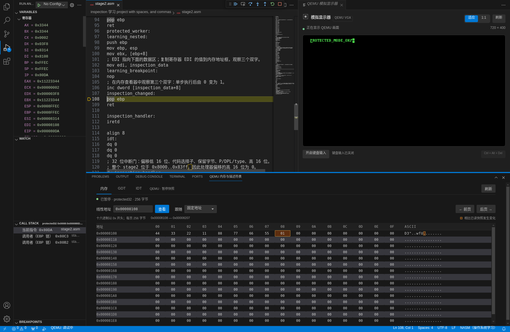
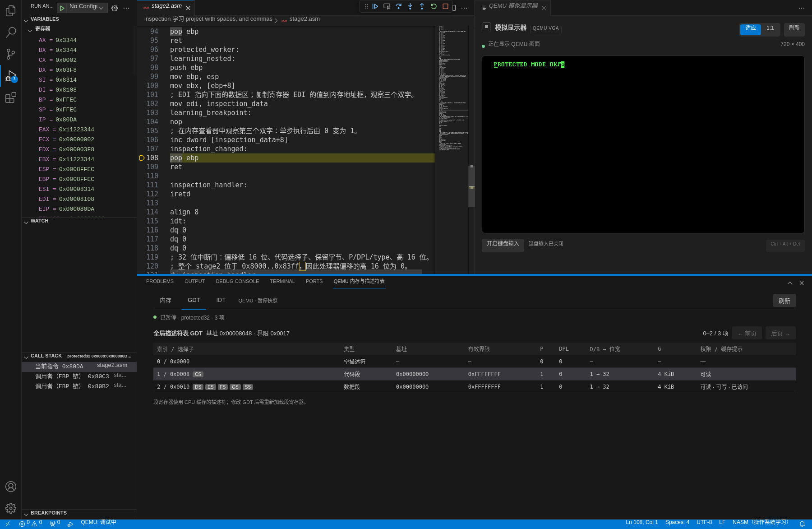
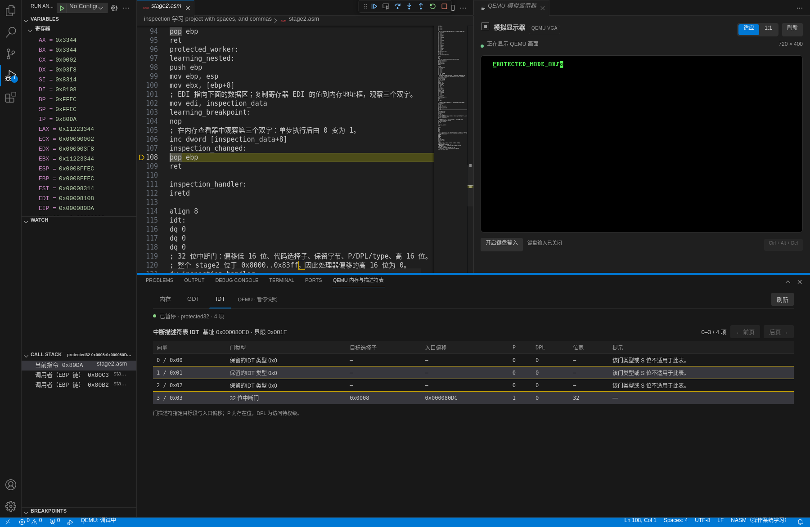

# 0.4.0 内存与描述符表

> 历史阶段记录：以下结果对应文中注明的版本、提交与执行环境，不是当前全部平台的兼容承诺。使用指南见[文档导航](README.md)，当前工具组合见[兼容性](COMPATIBILITY.md)。

日期：2026-10-15。环境：Linux x86_64 / Debian 13、Node.js 22.23.3、NASM 2.16.03、QEMU 10.0.13 TCG。真实宿主为官方 VS Code 1.96.4 和 1.142.0，使用 Xvfb。

## 学习流程

在可信工作区创建一个新的“二阶段保护模式项目”，打开 `stage2.asm`，在 `learning_breakpoint` 后的 `nop` 指令设置断点。执行“QEMU Assembly: 开始引导调试”，继续到该断点，再执行“QEMU Assembly: 查看内存与描述符表”。底部“QEMU 内存与描述符表”中的“内存与描述符表”视图与右侧模拟显示器可以同时打开。

### 内存与栈

- 在“线性地址”输入框输入 `0x` 开头的十六进制数或十进制数，点击“查看”。每页读取 256 字节，以每行 16 字节和 ASCII 显示；地址接近 4 GiB 末尾时只读取剩余字节。“前页 / 后页”按 256 字节移动。当前支持的 CPU 模式均关闭分页，线性地址与物理地址相同。
- 在“跟随”选择 `SS:ESP / SP` 或 `SS:EBP / BP`，观察当前栈指针或帧指针附近的内存。地址使用实际 SS 缓存的基址和 B 位：16 位栈使用低 16 位指针，32 位栈保留完整指针。输入固定地址或翻页会回到“固定地址”。
- 在断点处查看栈中的上一层 EBP、返回地址与 `0x11223344` 参数，对照“变量 → 栈内存”和“调用堆栈”。单步后，变化的字节会高亮；只对前后均读取到的相同地址比较，首次读取没有变化基线。
- 示例的 `inspection_data` 包含 `0x11223344`、`0x55667788` 和一个初始为零的双字。断点前把它的地址放入 EDI；在“变量 → 寄存器”查看 EDI，或在调试控制台输入 `$edi`，把得到的十六进制数值复制到内存地址框。地址框不解析标签或寄存器名，不要直接输入 `inspection_data`、`EDI`，也不要把旧版本示例中的数值地址当成固定常量。
- 从 `learning_breakpoint` 继续单步经过 `inc dword [inspection_data+8]`，观察第三个双字由零变为一。内存按字节显示，因此这次小端双字递增会改变最低地址处的一个字节。

### GDT 与段寄存器

1. 在实模式的 `lgdt [gdt_descriptor]` 处设置断点并重启调试，观察执行前后的 GDTR。表基址和界限来自 CPU 状态，每项 8 字节；界限是最后一个有效字节的偏移。
2. 打开 GDT 页，查看空描述符、32 位代码段和数据段。界面解码类型、基址、实际界限、P/DPL、G 和默认位宽；悬停表格行可查看原始字节。
3. 从面板读取当前 GDT 的基址，切回内存页输入这个地址，对照描述符的原始 8 字节。G=1 时，实际界限为 `(原始界限 << 12) | 0xfff`；不要把 20 位原始界限直接当成字节数。
4. 单步经过 `mov cr0, eax` 和 `jmp 0x08:protected_entry`，观察 PE 已置位但 CS 尚未重新装载的过渡状态。远跳转后 CS 选择子 0x08 指向 GDT 第 1 项；执行段寄存器装载后，DS/ES/FS/GS/SS 的 0x10 指向第 2 项。面板会标记使用各 GDT 项的当前段选择子。

选择子的低两位是 RPL，第 2 位是 TI，其余位为表索引。GDT 行上的选择子标记只说明当前选择子的索引，不保证缓存内容始终与内存中的描述符一致；CPU 装载段寄存器后会缓存描述符，后续改写表项不会自动更新缓存。LDT 表本身不在本轮范围内。

### IDT 与实模式向量表

- 实模式按 4 字节的段:偏移向量查看 IVT；进入保护模式后按 8 字节项解码 IDT 门。表基址和界限使用当前 IDTR。界面每页 64 项，用“前页 / 后页”翻页；读取受表界限限制，调试接口每次最多允许 128 项。
- 新示例在建立 32 位段和栈后执行 `lidt [idt_descriptor]`。在该指令前后分别暂停，可以看到 IDTR 的变化。
- 示例只保留前四个 IDT 项，其中向量 3 是选择子 0x08 的 32 位中断门，目标为 `inspection_handler`，处理器只有一条 `iretd`。前 3 项全零，P=0，未提供有效的门；查看 P、DPL、门类型、选择子与目标偏移，并与原始字节对照。
- 示例仍保持 IF=0，不主动触发中断，也没有完整异常处理、PIC 配置或中断栈实验。该 IDT 用于学习表结构，不是可安全处理全部异常的内核模板。

## 读取边界

面板只在可信工作区中的当前 `qemu-asm` 调试会话暂停时读取 CPU 与客体内存。它不写寄存器、内存或描述符，也不执行调试控制台表达式。继续运行时保留上次暂停快照，标注“上次快照”并弱化显示，停止读取并禁用导航；重新暂停后读取新快照。重启、终止或切换调试会话会清空结果和变化比较的基线。关闭或隐藏视图不停止 QEMU，隐藏期间不主动读取。

读取地址、长度、描述符条数与表界限均有边界检查。失效或不可读取的地址显示错误，不补造内存。支持标准实模式与无分页 16/32 位保护模式；分页、64 位、VM86、SMM 与 unreal mode 继续按已有调试限制拒绝。本轮不增加页表、LDT、任务切换、寄存器/内存写入或完整中断调试。

## 本轮验证

| 实际执行项目 | 结果 |
| --- | --- |
| `npm ci`、`npm run check`、`npm run compile` | 全部通过，TypeScript 严格模式 |
| `npm test` | 共 100 项，99 通过，0 失败，1 项大小写不敏感文件系统专用测试在 Linux 条件跳过 |
| `npm run test:inspection` | 通过：真实 QEMU 内存、IVT、GDT/IDT、栈跟随、数据变化、重启与清理 |
| 原有真实集成回归 | `test:integration`、`test:debug`、`test:display`、`test:stage`、`test:protected` 全部通过 |
| VS Code 1.96.4 / Linux x64 | 七阶段全部通过：可信、受限、多工作区、实模式调试、显示器、保护模式、内存与描述符表 |
| VS Code 1.142.0 / Linux x64 | 同上，七阶段全部通过 |
| 实际界面 / VS Code 1.96.4 | 通过：操作真实内存与 GDT/IDT 页签，单步后截取三张界面；内存数据与变化标记对应实际客体写入 |
| VSIX 0.4.0 | 打包通过；两版 VS Code CLI 在独立用户配置/扩展目录安装成功，列表均确认 `nothingzhl.vscode-qemu-asm@0.4.0` |

新增单测覆盖描述符字段解码、保留位和错误门类型、LDT 选择子、段缓存与 GDT 内容不一致的提示、读取边界、调试状态与信任检查。视图模型测试验证逐字节变化、地址与会话隔离、继续时的旧快照标记、重启清空、隐藏视图停止读取、并发读取合并及迟到响应丢弃；现有进程和显示器生命周期测试也通过。

### 真实 QEMU 证据

实模式从 `0x7c00` 读取真实引导扇区，检查末尾 `55 aa`；跟随 SS:SP 与调试表达式地址一致。IDTR 为基址 0、界限 1023，按 4 字节读取第 3 个 IVT 向量，并与客体原始内存逐字段对照，没有误按保护模式门解码。

保护模式示例实际执行 LGDT/LIDT 后，GDT 界限为 23，共 3 项，代码与数据段的基址均为 0、有效界限为 `0xffffffff`、默认位宽 32、P=1、DPL=0；当前 CS 和 SS 标记与 CPU 选择子一致。IDT 界限为 31，共 4 项；向量 3 的属性为 `0x8e`，目标选择子 0x08、DPL=0，32 位入口偏移与真实 NASM listing 中 `inspection_handler` 的指令地址一致。越过表末尾时返回空页或不足一页的有效项，不读取界限外的字节。

单步执行真实 PUSH 后，跟随 ESP 的地址从 `0x8fff8` 变为 `0x8fff4`，栈顶为 `0x11223344`，跟随 EBP 的地址保持不变。进入嵌套调用时，两种跟随均正确读取 `0x8ffec` 附近的栈。单步执行示例的 INC 后，三双字中的第三个值由 0 变为 1，实际只有一个字节改变；重启后重新构建、加载客体，数据恢复为 0。

另用独立真实客体将 SS.base 设为 `0x100000`，ESP/EBP 为 `0x17ffec`，两种跟随均得到完整线性地址 `0x27ffec`，读取到正确参数，没有忽略段基址或截断高 16 位。非法地址、越过 4 GiB 的范围、错误计数/表名、失去 Workspace Trust、CPU 运行中及会话结束后的读取均被拒绝。重启、断开与测试退出后，所有插件启动的 QEMU 均已结束。

### 真实 VS Code 宿主

两版宿主都在独立用户配置与扩展目录中运行完整七阶段。新增 inspection 阶段从未激活的扩展执行命令，实际创建底部 WebviewView、加载媒体脚本，确认仅打开视图不会启动 QEMU；随后经真实 DAP 请求获得 BIOS IVT、保护模式内存、GDT/IDT 与 SS:ESP 快照。继续后旧数据被标记，下一次暂停刷新；重启与新会话重置字节比较历史，终止清空快照并回收 QEMU。

### 真实界面

以下三张截图来自 Linux / VS Code 1.96.4 的同一真实调试会话，工作台截图为 1800×1172。源码、变量、调用栈、底部视图和右侧 QEMU VGA 均来自运行中的扩展宿主，没有绘制模拟界面或替换客体数据。



执行 `inc dword [inspection_data+8]` 后停在 `pop ebp`。EDI 指向本次构建的数据地址 `0x8108`，前 8 字节保持不变；`0x8110` 处的值从 `00` 变为 `01`，十六进制和 ASCII 区域均有变化标记。



GDT 显示 CPU 当前基址与界限，代码项标记 CS，数据项标记 DS/ES/FS/GS/SS；两项均为基址 0、有效界限 `0xffffffff` 的 32 位段。



IDT 显示向量 3 的 32 位中断门，目标选择子 0x08、P=1、DPL=0；前三个全零项明确提示不是有效门。截图中的数据和表地址属于本次构建，学习时应从 EDI、GDTR、IDTR 获取实际值。

使用 `npm run test:inspection:ui` 可重复界面验收并截图。脚本要求 Node.js 22；本轮 Linux 验收使用 Xvfb、Python 3 标准库和系统 libX11 调整真实窗口，通过本地 CDP 操作控件。输出为 `qemu-asm-inspection-memory.png`、`qemu-asm-inspection-gdt.png`、`qemu-asm-inspection-idt.png`，各图旁的 `.png.json` 保存实际 DAP 状态、DOM 和变化字节证据。该截图流程尚未在 Windows/macOS 原生执行。

### 验证日志与复现

- `inspection-unit-final.log`：100 项单测。
- `inspection-integration-final.log`：新增真实 QEMU 内存与描述符表集成。
- `inspection-boot-stage-regression.log`：单扇区、多阶段构建与引导回归。
- `inspection-debug-regression.log`：真实运行时与实模式 DAP 回归。
- `inspection-display-protected-regression.log`：显示器和保护模式 DAP 回归。
- `inspection-host-all-min.log`、`inspection-host-all-current.log`：两版宿主完整七阶段。
- `inspection-ui-test.log`：真实界面交互、三张截图与后续会话清理。
- `inspection-vsix-package.log`、`inspection-vsix-install-min.log`、`inspection-vsix-install-current.log`：打包与两版实际安装。

交付安装包为 `qemu-assembly-toolkit-0.4.0.vsix`。打包包含编译后的插件、内存与描述符表脚本/样式，以及显示器资源；未发布 VS Code Marketplace。

```sh
npm ci
npm run check
npm run compile
npm test
npm run test:integration
npm run test:debug
npm run test:display
npm run test:stage
npm run test:protected
npm run test:inspection
xvfb-run -a npm run test:host
```

集成脚本支持 `NASM_PATH`、`QEMU_PATH`。宿主支持 `VSCODE_EXECUTABLE_PATH` 指向本地 VS Code，或用 `VSCODE_VERSION=1.96.4` 指定下载版本。Windows/macOS 有桌面会话时直接运行 `npm run test:host`，不使用 Xvfb。

Windows/macOS 原生执行仍须单独验收；Linux 与路径语义测试不代表原生平台通过。
