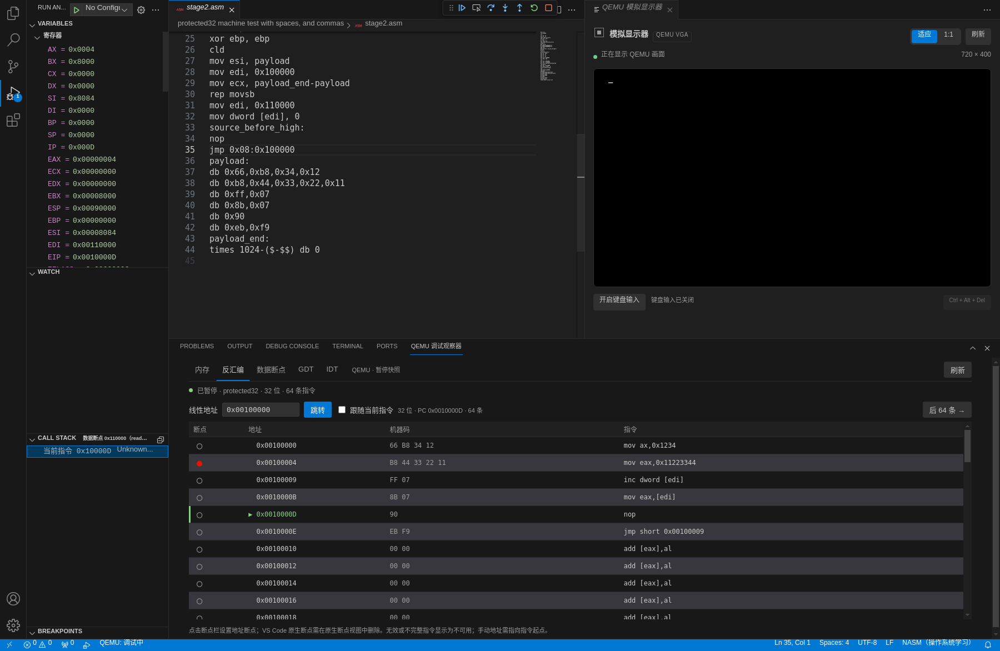
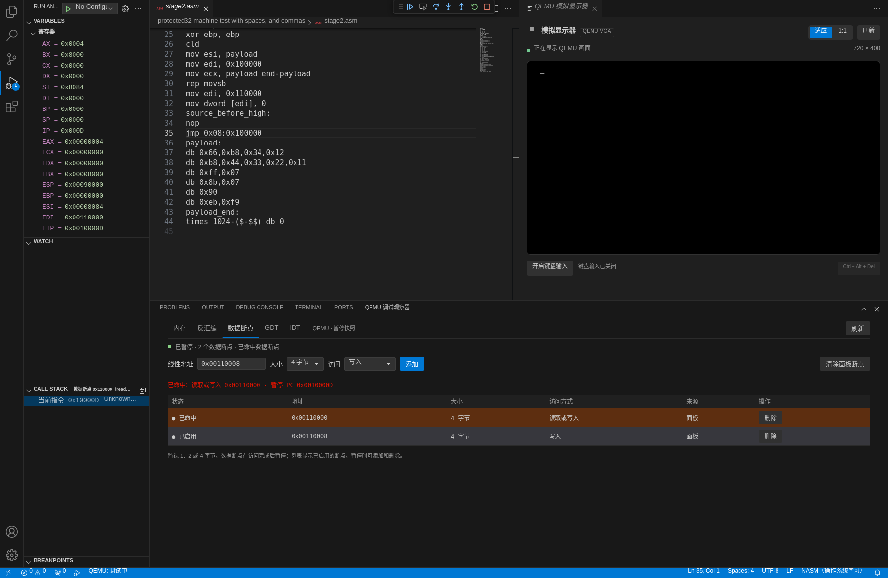

# 0.5.0 反汇编与数据断点

> 历史阶段记录：以下结果对应文中注明的版本、提交与执行环境，不是当前全部平台的兼容承诺。使用指南见[文档导航](README.md)，当前工具组合见[兼容性](COMPATIBILITY.md)。

日期：2026-10-15。环境：Linux x86_64 / Debian 13、Node.js 22.23.3、NASM 2.16.03、QEMU 10.0.13 TCG。真实宿主为官方 VS Code 1.96.4 和 1.142.0，使用 Xvfb。

本轮扩展调试工具本身：查看正在执行的机器指令、在指令地址断下，以及追踪指定内存的访问。不新增学习模板，也不要求已有源码必须使用新模板。

## 反汇编与地址断点

在可信工作区启动 QEMU 汇编调试并暂停，执行 **QEMU Assembly: 查看反汇编**，或在底部“QEMU 调试观察器”选择“反汇编”。同一视图包含内存、反汇编、数据断点、GDT、IDT 五个页签。反汇编默认跟随当前 PC，显示线性地址、机器码和 NASM 风格指令，每页 64 条。也可输入十六进制或十进制线性地址跳转，再查看下一页。指令地址来自实际 CPU 段缓存，解码位宽取自当前 CS；设置 CR0.PE 后、重新装载 CS 前仍按 16 位解码。

点击指令行的断点圆点可添加或删除该地址的面板断点。它与源码断点独立，因此没有 listing 映射的代码也能按地址暂停、单步，F10 可跳过 CALL。调试器同时实现标准 DAP `disassemble`、`setInstructionBreakpoints` 和栈帧的 `instructionPointerReference`，供 VS Code 原生反汇编视图使用。最多设置 256 个不同的指令地址断点。

解码器 iced-x86 的 WebAssembly 随安装包分发，不执行外部反汇编命令，也无需安装 GDB。反汇编限于当前 CS 范围和当前执行模式；它不能自动推断另一代码段的基址或位宽。任意地址可能落在 x86 指令中间，输入地址应当是已知指令起点。每次最多读取 4096 字节、返回 256 条指令；向前读取可建立后续边界，向后偏移只有在当前停止 PC 到目标地址的正向解码链可证明时才显示真实前驱。无法可靠确定的前驱指令、无效编码或不可读字节会明确标记，不猜测指令。

## 数据断点

暂停时执行 **QEMU Assembly: 查看数据断点**，或选择“数据断点”页签：

1. 输入目标内存的线性地址，选择 1、2 或 4 字节长度，以及“写入”“读取”或“读取或写入”。支持非对齐范围，但不能越过 32 位地址空间。
2. 点击“添加”，再继续执行。匹配范围被客体访问时，QEMU 通过 RSP 数据监视点暂停，不靠插件循环读取内存判断变化。
3. 查看最近命中的地址、访问类型及暂停 PC，再对照反汇编、寄存器和内存。数据断点在访问指令完成后停下，PC 指向后续指令；监视地址和 PC 是不同含义，不应把 PC 当成被访问的内存地址。
4. 可删除单项或清除面板创建的全部数据断点。最多允许 16 个不同的数据断点；重复配置合并使用同一监视点。

标准 DAP `dataBreakpointInfo` / `setDataBreakpoints` 也支持数据断点。面板会标注断点来自面板、VS Code 原生界面，或两者共有；面板的删除和清除只移除面板所有权，VS Code 原生界面仍持有的配置继续生效。指令地址断点采用同样的独立所有权，源码断点继续生效。

原生数据断点可针对“变量 → 栈内存”中的槽位，按当前代码位宽监视 2 或 4 字节；调试接口也接受数值地址及明确的字节长度。标签、通用表达式和寄存器值不作为内存地址自动求值。

QEMU 的命中报告包含所命中的监视点起始地址与配置类型，不包含实际内存操作的完整起点、长度。“读取或写入”表示配置类型，不能用它判定本次究竟读取还是写入。若同一起点、同一类型配置了不同长度，命中 ID 可能包含多个候选项；不同起点的重叠范围不会被笼统标成全部命中。

## 状态与范围

读取和修改都要求可信工作区、当前 QEMU 调试会话暂停。继续执行后保留灰显的“上次快照”，禁用导航和修改；隐藏视图时不主动读取。再次暂停后刷新，迟到响应不会覆盖新会话或新暂停状态。重启同一调试会话会重新安装断点配置，但清空旧指令、数据快照和最近命中信息；终止或切换会话不会复用旧客体的命中状态。

支持标准 16 位实模式、切换至保护模式时的 16 位过渡状态和无分页 32 位保护模式。分页、64 位、VM86、SMM 和 unreal mode 仍不支持；线性地址在当前支持范围内等于物理地址。数据断点不提供条件、命中次数、日志或复杂表达式；本轮不增加寄存器/内存修改、ELF/DWARF 展开或反向执行。

## 验证记录

| 项目 | 状态 |
| --- | --- |
| `npm ci`、`npm run check`、`npm run compile` | 全部通过，TypeScript 严格模式 |
| `npm test` | 共 141 项，140 通过，0 失败，1 项大小写不敏感文件系统专用测试在 Linux 条件跳过 |
| 真实 QEMU 运行时数据监视点 | 通过：16/32 位读、写、读写与非对齐范围，继续、单步和指令断点共存 |
| 真实 DAP 反汇编、指令与数据断点 | 通过：实际字节解码、无源码地址断点、原生/面板配置共存、重复命中、重启与会话隔离 |
| 原有构建、调试、显示器与检查视图回归 | 七个真实集成脚本全部通过 |
| VS Code 1.96.4 / Linux x64 宿主 | 新增 machine 阶段和原有七阶段分别执行，合计八阶段全部通过 |
| VS Code 1.142.0 / Linux x64 宿主 | 同上，合计八阶段全部通过 |
| 实际界面 / VS Code 1.96.4 | 通过：真实控件操作、地址跳转、两类断点增删与 DAP 独立核对，截取两张运行界面 |
| VSIX 0.5.0 打包、安装与运行 | 打包通过，包含 iced-x86 WebAssembly；两版 VS Code 均成功安装，且实际加载安装包完成源码调试与数据断点验证 |
| Windows / macOS 原生执行 | 尚未验证 |

### 真实 QEMU 与 DAP

运行时脚本实际验证 RSP `Z2`、`Z3`、`Z4` 监视点与停止包解析，包括逐字节、字和双字访问、非对齐范围、单步命中、继续后再次命中，以及从指令断点内部跨过原指令时不丢失数据断点。无效长度、类型、溢出范围和会话运行中的修改被拒绝；替换断点失败时恢复原配置，恢复也失败则结束会话，避免继续使用未知远端状态。

DAP 集成先验证实模式 `66` 前缀与实际 16 位解码，再让真实客体进入保护模式，将代码复制到 `0x100000`、数据放到 `0x110000`。该代码没有 listing 映射，仍能设置原生地址断点并得到真实 32 位反汇编；指令包含 `mov ax,0x1234`、`mov eax,0x11223344`、`inc dword [edi]` 和 `mov eax,[edi]`。原生写入断点及面板读取/读写断点会在实际 INC/MOV 访问后停下，PC 与被访问的数据地址分别返回。继续和单步均可再次触发，而非仅首次命中。

另一个真实客体在没有源码映射的 `0x100005` 执行 E8 CALL，F10 通过反汇编确定返回边界，实际运行处理函数的 INC/RET，再停在 `0x10000a`，ESP 恢复；没有退化为进入处理函数的单步。

集成还检查原生与面板共享/独立所有权、16 个数据断点上限、非法输入、源码断点共存、重启保留断点配置并重新安装、清除旧命中，以及新会话隔离。失去 Workspace Trust、CPU 运行中和会话结束后的读取/修改被拒绝。每次重启与断开后，插件启动的真实 QEMU 均已结束。

### 真实宿主与界面

VS Code 1.96.4 和 1.142.0 的新增 machine 宿主阶段均通过，使用实际扩展、NASM、QEMU 和 DAP 请求，没有模拟 VS Code 调试 API。公开反汇编/数据断点命令可从未激活状态打开对应页签，不会仅因打开视图就启动 QEMU。底部 WebviewView 得到真实反汇编和读写断点命中，运行时旧快照、下一次暂停刷新、重启/终止清空与进程清理均有验证。两版还分别重跑可信、受限、多工作区、实模式调试、显示器、保护模式与内存/描述符表七阶段，全部以 0 退出。

以下截图来自 Linux / VS Code 1.96.4 的同一真实调试会话，工作台为 1800×1172。脚本通过本地 CDP 操作实际输入框、按钮和断点圆点，每次修改后通过独立 DAP 请求核对后端列表；没有替换客体数据或绘制模拟界面。



已跳转到 `0x100000`，`0x100004` 的圆点是实际添加的指令地址断点；当前 PC 位于 `0x10000d` 的 `nop`。列表同时展示 16 位操作数前缀与完整 32 位立即数，右侧为真实 QEMU VGA。



`0x110000` 的 4 字节读写监视点已命中，暂停 PC 为 `0x10000d`；它们分别是数据地址与访问完成后的执行位置。第二行 `0x110008` 是通过真实表单新加的写入断点，两项均经 DAP 独立核对。后续脚本删除新增断点，确认后端列表同步，再重启和断开清理客体。

`npm run test:machine:ui` 可重复操作并截图，要求 Node.js 22；本轮 Linux 使用 Xvfb、Python 3 标准库和系统 libX11 调整真实窗口。输出为 `qemu-asm-machine-disassembly.png` 和 `qemu-asm-machine-watchpoints.png`，旁边的 `.png.json` 保存 DAP、DOM 和后端断点证据。该截图脚本尚未在 Windows/macOS 原生执行。

### 安装包实际运行

两版 VS Code 均在独立扩展目录安装 VSIX，再启动宿主加载该安装目录中的插件；测试文件复制到另一临时目录，产品代码只从已安装的扩展读取。实际加载的解码器路径位于安装目录的 `node_modules/iced-x86/iced_x86.js`，WebAssembly 不依赖仓库的 `node_modules`。实模式/保护模式反汇编、源码 NOP/INC 单步、写入数据断点、真实 RAM 值为 1 以及 QEMU 退出全部通过，宿主均以 0 退出。

可将 `QEMU_ASM_VSIX_EXTENSION` 设置为 VSIX 实际安装的扩展目录，再运行 `npm run test:vsix:machine` 复现；该脚本拒绝使用当前仓库目录充当安装包证明。Linux 无桌面环境时使用 `xvfb-run -a`。

### 日志与复现

- `machine-unit-final.log`：141 项单测。
- `machine-integration-final.log`：真实 QEMU 运行时与完整机器调试 DAP 集成。
- `qemu-machine-integration.log`：追加无源码 CALL/RET 的实际 F10 验证。
- `machine-prior-integrations.log`：原有七个真实集成脚本回归。
- `qemu-machine-host-min.log`、`qemu-machine-host-current.log`：两版新增 machine 宿主阶段。
- `machine-host-regression-min.log`、`machine-host-regression-current.log`：两版原有七阶段宿主回归。
- `qemu-machine-ui.log`：真实界面交互、两张截图与后续清理。
- `machine-vsix-package.log`、`machine-vsix-install-min.log`、`machine-vsix-install-current.log`：打包与两版实际 CLI 安装。
- `machine-vsix-proof-min.log`、`machine-vsix-proof-current.log`：两版实际宿主从安装包加载 WebAssembly、执行调试与清理。

交付安装包为 `qemu-assembly-toolkit-0.5.0.vsix`，包含编译后的插件、检查视图/显示器资源和 iced-x86 的 JavaScript/WebAssembly。原有模板保持不变，未发布 VS Code Marketplace。

真实 QEMU 脚本接受 `NASM_PATH`、`QEMU_PATH`，宿主接受 `VSCODE_EXECUTABLE_PATH` 或 `VSCODE_VERSION`。Linux GUI 验证需要 Xvfb；Windows/macOS 已有桌面会话时直接运行宿主测试。

```sh
npm ci
npm run check
npm run compile
npm test
npm run test:machine
npm run test:integration
npm run test:debug
npm run test:display
npm run test:stage
npm run test:protected
npm run test:inspection
xvfb-run -a npm run test:host
xvfb-run -a npm run test:machine:ui
```

Linux 结果和 Windows 路径语义测试不代表 Windows/macOS 原生平台通过。不自动发布 VS Code Marketplace。
