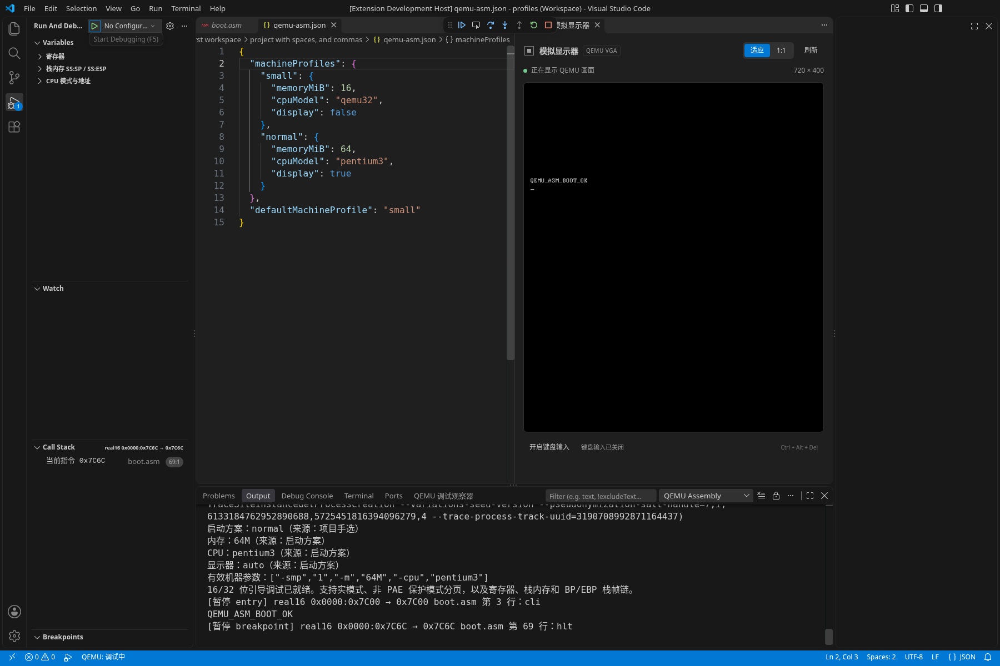

# 启动方案验收：0.9.0

执行日期：2026-10-16。分支：`feat/machine-launch-profiles`，基于 `8499b21`。本文记录本分支实际执行的结果；历史验证不代替本次验收。使用方法见[配置参考](CONFIGURATION.md#启动方案)。

## 已交付行为

- 项目 `qemu-asm.json` 支持多套命名方案，配置内存、CPU 型号和内嵌显示器；运行与 NASM/C 调试使用同一套解析结果。
- 命令 **选择启动方案** 提供真实 QuickPick；**配置启动方案** 打开真实 JSON 文件，提供 Schema 补全和校验。编辑命令不重写用户文件。
- 选择顺序为 `launch.json` 显式方案、项目手选、项目默认、原有工作区配置。手选按工作区 URI 与项目根 URI 隔离；取消选择不改变已保存结果。
- 切换在下次启动或重启生效。重启重读配置；显式启动项保持方案名称，未显式指定时重新解析手选或默认值。正在运行的客体保留原有配置。
- 输出和依赖报告说明方案来源、实际内存/CPU/显示设置及有效机器参数。未设置的 QEMU 默认值保留未知，不猜测数值。
- CPU 型号通过本次实际使用的 QEMU 查询。无效方案、未知字段、非法数值或不可用型号明确失败；错误不会启动备用客体。

## 真实界面

VS Code 1.142.0 的开发宿主，运行真实 NASM 客体，在输出 `QEMU_ASM_BOOT_OK` 后停在 `hlt`。配置中项目默认是 `small`，本次手选 `normal`；输出显示 `-m 64M -cpu pentium3`，右侧是通过 QMP 获取的真实画面。截图没有拼接或替换内容。



同一暂停会话打开公共命令的方案选择器，可看到“项目默认方案”和“当前手选方案”：


录制入口为 `npm run test:profiles:ui`。它会检查真实客体参数、显示连接和 JSON 编辑器，保存两张截图，再实际操作选择器并继续完成宿主测试；截图失败或宿主断言失败均返回非零状态。

## 本次验证

Linux x64；Node.js 22.23.3；主工具组合为 NASM 2.16.03、QEMU 10.0.13、GDB 16.3、GCC 14.2、binutils 2.44。工具路径包含空格；QEMU 使用 TCG。

| 检查 | 本次结果 |
| --- | --- |
| `npm ci`、`npm run check`、干净编译 | 通过 |
| `npm run test:coverage` | 402 项，401 通过、1 项文件系统条件跳过、0 失败 |
| 覆盖率 | 语句/行 83.23%，分支 86.65%，函数 92.22%；全部超过仓库门槛 |
| 完整真实工具套件 | 15 组全部通过，含新启动方案专项与原有 NASM/C、显示、分页、内存等回归 |
| VS Code 1.96.4 | 完整 12 个宿主阶段通过；独立安装 VSIX 的 5 组验证通过 |
| VS Code 1.142.0 | 完整 12 个宿主阶段通过；独立安装 VSIX 的 5 组验证通过；真实界面截图通过 |
| 性能预算 | 模块、资源生命周期、真实 QEMU 显示三组预算通过 |
| 工作流与文档 | actionlint 1.7.7 / ShellCheck 0.10.0、文档校验与 `git diff --check` 通过 |

新增测试实际检查了以下场景：

- 项目默认、手选、显式启动项的优先级；字段继承；多工作区及同一工作区切换项目目录；文件读取期间配置发生变化。
- QuickPick 取消和键盘选择；未信任工作区、工作区移除、配置删除、非法配置、未知 CPU；失败不保存新选择，不启动客体。
- 用真实 QEMU 内存映射确认 16/64 MiB，用 QMP 查询实际 CPU 类型，分别验证显示开关是否分配 QMP 资源。
- NASM 无 GDB 仍可调试；C/GDB 读取真实 DWARF 变量并在切换方案后重启；旧帧和变量句柄失效；停止和失败后清理全部自有进程。
- 修改下一次启动方案后，报告区分新选择与既有会话的真实机器范围，避免把未生效配置当成运行状态。
- VSIX 在仓库外独立安装执行，产品从安装目录加载，确认 Schema、命令以及 iced-x86 JS/WASM 均随包提供。

性能结果仅说明已有预算未回归，不据此宣称插件整体加速或内存下降。模块测试不包含完整 VS Code UI 或 QEMU 子进程；真实显示测试单独报告 QEMU 资源。显式 CPU 型号每次启动增加一次有超时、输出上限和取消处理的查询，不使用跨工具或会话的缓存。

## 旧工具组合

本次在三个实际 Ubuntu 容器中使用发行版工具重跑兼容套件；均完成 NASM/RSP、16/64 MiB 启动方案、CPU/显示切换、未知 CPU 清理及 C/GDB 的 DWARF、步进、变量、栈、断点和分页场景。

| 发行版 | NASM | QEMU | GDB | GCC | 结果 |
| --- | --- | --- | --- | --- | --- |
| Ubuntu 20.04 | 2.14.02 | 4.2.1 | 9.2 | 9.4 | 通过 |
| Ubuntu 22.04 | 2.15.05 | 6.2.0 | 12.1 | 11.4 | 通过 |
| Ubuntu 24.04 | 2.16.01 | 8.2.2 | 15.1 | 13.3 | 通过 |

20.04 另执行完整启动方案专项，覆盖 C/GDB 方案重启。三个发行版组合不是所有版本任意混搭的保证，也不据此推定最低版本。

本次发现并修复 NASM 2.14 listing 的真实格式差异：无重复次数的 `<rept>` 和无 `h` 后缀的 `<res>`。解析器从下一偏移或真实二进制长度确定边界，遇到歧义、矛盾或越界时拒绝。仓库保留原始固定列 listing 样本及回归断言，不把补齐字节伪装成源码地址。修复单独提交为 `a0bb7a8`。

## 复现与产物

按[开发指南](DEVELOPMENT.md)准备工具、两版 VS Code 及 Xvfb，然后执行：

```sh
npm ci
npm run check
npm run test:coverage
node scripts/ci/run-suite.cjs --suite full
npm run test:profiles
# 每个已准备好的 VS Code 可执行路径分别执行宿主与独立安装验证
npm run test:host
node scripts/ci/installed-tests.cjs --vsix ../vscode-qemu-asm-0.9.0-profiles.vsix
npm run test:profiles:ui
npm run docs:check
```

独立安装验证需要指定已生成的 VSIX 和 VS Code 路径；具体环境变量与性能、容器入口见开发指南和对应脚本。Linux 无桌面会话时，宿主、安装和截图命令通过 `xvfb-run` 执行。

本次产物为 `vscode-qemu-asm-0.9.0-profiles.vsix`，720033 字节；SHA-256：

```text
f0f9d69296373904db0afe867a7cf62d9b0641bd77f05005ecf7aa02e71ccfcf
```

原始结果位于本次执行环境的 `/tmp/qemu-profiles-final-{integration,host-min,host-current,installed-min,installed-current}/results.json`、`/tmp/qemu-profiles-compatibility/ubuntu-*/result.json`；覆盖率及截图日志分别为 `/tmp/qemu-profiles-final-coverage.log`、`/tmp/qemu-profiles-final-ui-retry.log`。这些临时路径不是仓库内永久产物；CI 配置会上传其本次运行的结果及日志。

## 验证边界

上述首次验收实际执行为 Linux x64。Windows、macOS、其他工具混搭及更旧 GDB 版本不包含在该本地通过范围内。首次验收时 GitHub Actions API 不可访问；合并前已恢复访问，后续原生矩阵、修复和最终结果见 [PR #2](https://github.com/nothingzhl/vscode-qemu-asm/pull/2) 的对应提交与检查，不能由本地通过推定远端通过。本文安装包哈希记录初次交付，后续修复包以对应提交的 CI 产物为准。

当前配置界面为带 Schema 的 JSON 编辑器和方案选择器。独立图形编辑器、磁盘、网络、UEFI、SMP、KVM、64 位及运行中热切换不属于本阶段交付。

## 合并前补充检查

原生 CI 暴露了测试路径别名、Windows 测试替身错误拦截 `taskkill`、NASM 3 跳转优化、Windows NASM/QEMU 中文项目根参数编码，以及旧测试工具不能启动新版 VS Code 的差异。修复保留原有命令、停点、错误与清理断言；源码文件和安装目录以双方 `realpath` 比较身份，启动路径契约仍独立校验。开发依赖升级使用官方宿主解析和原生 `.exe` 参数传递；工具差异与适配说明见[兼容性](COMPATIBILITY.md#已发现并修复的差异)。

补充本地环境为 Node 22.23.3、NASM 3.02、QEMU 10.0.13。405 项测试中 404 通过、1 项文件系统条件跳过，语句/行 83.26%、分支 86.69%、函数 92.23%；汇编调试、保护模式、显示器及完整运行时专项均使用真实 QEMU 通过。Windows 相对路径参数另有实际临时文件与生成镜像的契约测试，并验证 VM 消费的实际宿主、工作目录、逗号和跨盘边界；原生平台执行仍以 PR 检查为准。
