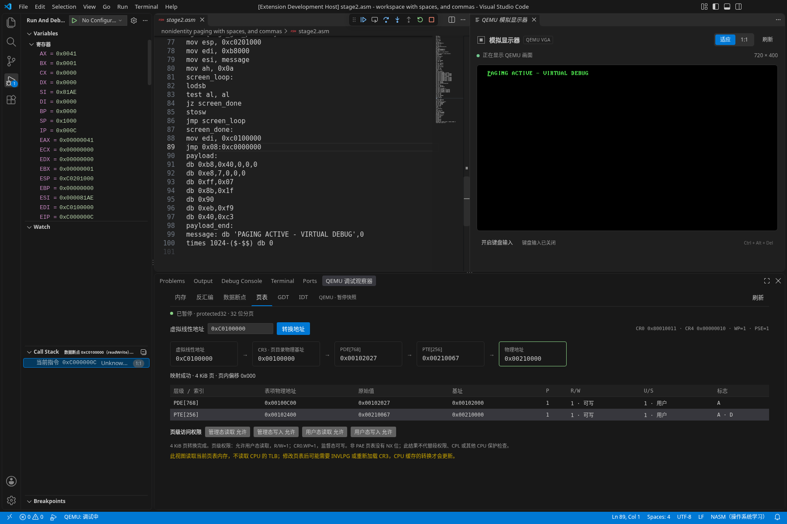

# 0.6.0 分页与地址转换

> 历史阶段记录：以下结果对应文中注明的版本、提交与执行环境，不是当前全部平台的兼容承诺。使用指南见[文档导航](README.md)，当前工具组合见[兼容性](COMPATIBILITY.md)。

日期：2026-10-15。环境：Linux x86_64 / Debian 13、Node.js 22.23.3、NASM 2.16.03、QEMU 10.0.13 TCG。真实宿主为官方 VS Code 1.96.4 和 1.142.0，使用 Xvfb。

本页记录 32 位非 PAE 分页调试的范围与实际验证；旧版文档中的“分页不支持”属于当时版本。本轮测试客体只在临时目录生成，不增加面向用户的学习模板。

## 地址与页表

暂停后执行 **QEMU Assembly: 查看分页与地址转换**，在底部“QEMU 调试观察器”的“页表”页签输入虚拟线性地址。地址先由段寄存器形成，再进行分页转换；这里输入的是分页前的线性地址，而非 `CS:EIP` 这样的段内偏移。

查看器从当前 CR3 读取物理内存中的页目录项及页表项，展示表项索引、物理地址、原始值、基址、P、R/W、U/S 和标志，给出最终物理地址及页大小。未开启分页时明确显示恒等转换；不存在的表项不产生物理地址。

支持 4 KiB 页和 CR4.PSE 开启时的 4 MiB 大页，物理地址限定为 32 位。4 MiB 项的 PAT 位合法；保留位 21 置位报告无效，PDE[20:13] 非零报告不支持 PSE-36，不截断高物理地址。CR4.PSE=0 时忽略 PDE.PS，按普通 4 KiB 页表解释。PAE 与 64 位分页不在本轮范围。

4 KiB 页的有效 R/W、U/S 分别合并 PDE 与 PTE；监督态写入还受 CR0.WP 影响。显示的是页级读写权限，不代替段权限、CPL 或 SMEP/SMAP 等额外检查；非 PAE 表项没有 NX 位。调试器能读取字节，不代表客体当前权限允许同样访问。

## 虚拟与物理内存

在“内存”页签选择“虚拟内存”或“物理内存”，同一个数值地址可用于对照映射前后的内容。虚拟内存使用当前 CPU 的地址空间；物理内存按物理地址读取，绕过分页。物理模式使用固定地址，栈指针跟随只用于虚拟模式。页表始终从物理内存读取，不要求页目录或页表被映射到当前虚拟地址空间。

普通调试表达式、反汇编、栈和指令/数据断点仍使用虚拟线性地址，切换内存页签的地址空间不会改变断点含义。读取要求可信工作区且 CPU 暂停；运行时保留标注的旧快照。继续、重启、终止和切换会话时沿用调试观察器的刷新与隔离规则。

NASM listing 描述原始加载地址。开启分页后，只有验证为恒等映射的原地址才显示对应源码；虚拟别名不自动取得原文件的源码行。源码断点仍按 listing 的原始线性地址设置，不会随重映射移动；重定位或别名代码应使用地址断点和反汇编。若该原地址被映射为其他内容，断点仍针对同一线性地址。

页表查看器解释当前内存中的表项，不读取 CPU TLB，也不代替客体的实际访问检查。客体修改表项后尚未刷新 TLB 时，两者可能暂时不同。

物理读取需要 QEMU 的 `qqemu.PhyMemMode` 扩展。读取期间的物理模式切换、分块读取及恢复虚拟模式作为一个操作串行执行；错误后也恢复。恢复失败会关闭连接并清理本会话 QEMU。缺少该扩展时明确提示，不把虚拟内存伪装成物理结果；普通虚拟机器级调试仍可继续。

## C 内核的调试范围

进入保护模式后执行的 C 代码最终也是机器指令。已经由客体加载并执行的兼容 32 位代码，可以使用当前机器级工具查看寄存器、原始栈、内存和反汇编，并设置指令地址或内存数据断点。

当前构建仍为 NASM `-f bin`；插件没有 C 编译/链接流程、外部内核镜像入口、ELF 符号或 DWARF 解析。因此不能直接导入普通 C 内核项目，也不提供 C 源码行断点、按 C 行单步、局部变量/结构体显示或可靠的 C 调用栈展开。现有 EBP 链只适用于符合校验条件的 near CALL 栈帧，优化或省略帧指针的 C 代码不保证可展开。

`npm run test:c-machine` 已使用外部 GCC 14 的 `-m32 -ffreestanding -O0 -g` 编译真实 C 函数，由外部链接器生成含调试信息的 ELF32，再用 `objcopy` 取出 `.text`，仅在临时 NASM 测试固件中嵌入机器码。真实客体开启非恒等分页，代码 `0xc0000000` 映射到物理 `0x200000`，栈也使用非恒等映射。插件在 C 函数入口及 `0xc0000012` 的 CALL 地址断下，F10 实际执行调用和 RET 后停在 `0xc0000017`，EAX 为 42，ESP 恢复；虚拟地址 `0xc0100000` 的写入断点命中，虚拟内存与物理 `0x210000` 均为 42。C 文件的源码行断点明确返回 `verified:false`，栈帧不编造 C 源码位置，结束后真实 QEMU 退出。

这证明已加载 C 机器码的机器级调试可用，不代表插件已经读取 ELF/DWARF，或能够直接构建、装载普通 C 内核项目。

后续 C 源码级支持需要接入 ELF/DWARF、加载地址、编译配置和类型/变量求值。

## 验证记录

| 实际执行项目 | 结果 |
| --- | --- |
| `npm ci`、`npm run check`、`npm run compile` | 全部通过 |
| `npm test` | 176 项，175 通过，0 失败，1 项大小写不敏感文件系统专用测试在 Linux 条件跳过 |
| QEMU 物理读取 | 通过：虚拟/物理同地址读到不同数据，读取后恢复虚拟模式，数据断点仍报告虚拟地址 |
| 分页后的调试 | 通过：非恒等代码与栈、地址断点、32 位反汇编、F10 CALL/RET，以及原生写和面板读/读写数据断点 |
| 页表与内存 | 通过：4 KiB / 4 MiB、有效 U/S / R/W、CR0.WP、PDE/PTE 缺页、跨页读取与物理页表 |
| 生命周期与限制 | 通过：重启保留配置并清空命中、运行/失去信任拒绝读取、新会话隔离，以及全部 owned QEMU 退出 |
| VS Code 1.96.4 / Linux x64 | 新增 paging 阶段及原有八阶段通过，共九阶段；实际视图收到真实 DAP 快照与物理 RAM |
| VS Code 1.142.0 / Linux x64 | 同上，共九阶段通过 |
| 实际界面 / VS Code 1.142.0 | 通过：页表路径、缺页、虚拟/物理切换、栈跟随限制及真实截图 |
| 外部 GCC C 机器码 | 通过：非恒等分页后的 C CALL/RET、返回值 42、数据断点与物理 RAM；C 行断点返回 `verified:false` |
| 原有实际集成回归 | 运行时、反汇编/数据断点、内存/描述符集成均通过 |
| VSIX 0.6.0 打包、安装与独立运行 | 通过：42 个文件；两版安装成功，并从实际安装目录完成独立分页冒烟 |
| Windows / macOS 原生执行 | 尚未验证 |

### 真实 QEMU

`scripts/physical-memory-integration.cjs` 建立 `0x3000 → 0x4000` 映射，同一数值地址的虚拟读取为 `0x22222222`，物理读取为 `0x11111111`；写入断点报告虚拟 `0x3000`，实际写入物理 `0x4000`。

`scripts/paging-integration.cjs` 的临时客体把代码 `0xc0000000` 映射到物理 `0x200000`，使用非恒等映射的栈，且不把页目录/页表映射到当前虚拟空间。在虚拟 `0xc0000005` 的 CALL 断下，F10 执行真实 CALL/RET 后停于 `0xc000000a`，EAX 从 40 变为 41，ESP 恢复为 `0xc0201000`。该代码没有 listing 源码映射，栈帧没有附会原文件。

另一个真实客体将原阶段虚拟 `0x8000` 重映射到物理 `0x250000`，把 listing 中 `0x8188` 的单字节 NOP 换成实际五字节 CALL。暂停时不再显示旧源码，F10 按实际指令长度执行调用，停于 `0x818d`，EAX 从 40 变为 41、ESP 恢复；没有借用旧 NASM 指令长度。

页目录基址为物理 `0x100000`，高地址页表位于物理 `0x102000`。`0xc0100003` 经目录索引 768、页表索引 256 转换为 `0x210003`；只读页 `0xc0101000` 在 CR0.WP=1 时显示监督态不可写。`0xc0102000` 缺页表项，`0x40000000` 缺页目录项；两者都不返回物理地址。大页 `0x80000123` 直接经 PDE 转换为 `0x400123`，页大小为 4 MiB。

同一地址 `0x200000` 的虚拟内存含 `0xaabbccdd`，物理内存含实际代码 `b8 40 00 00 00`。物理读取前后再次虚拟读取，确认地址空间恢复；读取 8 字节跨过真实 4 KiB 页边界，结果与两页内容一致。GDTR 使用非恒等虚拟地址 `0xc0300000`，GDT 仍由虚拟读取正确解码。原生写、面板读和读写数据断点监视虚拟 `0xc0100000`，实际 RAM 从 0 变为 1、2，命中 ID 与停止 PC 分别核对。

### 真实宿主

两版 VS Code 的新增 paging 阶段均以 0 退出，使用实际扩展、NASM、QEMU 和 VS Code DAP，没有替代调试 API。公开 `qemuAsm.showPaging` 命令从冷启动打开“页表”页签，单纯打开视图不会启动客体。实际 WebviewView 接收当前 CR3、PDE/PTE、转换结果与物理 RAM；客体运行时拒绝新读取，重启及断开后没有遗留本会话 QEMU。

两版另分别重跑可信、受限、多工作区、实模式调试、显示器、保护模式、内存/描述符表、反汇编/数据断点八阶段，均以 0 退出。合计每版九阶段。

### 真实界面

`npm run test:paging:ui` 在 VS Code 1.142.0 / Linux 通过本地 CDP 操作真实表单，核对页表路径、表项物理地址、页级权限、缺页时不产生物理地址，以及内存虚拟/物理切换的一致结果。选择物理模式会退出 SS 栈跟随并禁用跟随控件；重新选择虚拟模式后内容仍正确。截图后继续执行重启、新会话、运行期间限制和进程清理，整轮以 0 退出。



截图中的 CPU 停在虚拟 `0xc000000c`，CR0.PG=1、CR0.WP=1、CR4.PSE=1。输入 `0xc0100000`，页目录基址为物理 `0x100000`，PDE[768] 位于 `0x100c00`，PTE[256] 位于 `0x102400`，最后得到物理 `0x210000`、4 KiB 页。右侧真实 VGA 显示 `PAGING ACTIVE - VIRTUAL DEBUG`。没有合成客体数据或重绘界面；`qemu-asm-paging.png.json` 保存实际 DAP/DOM 证据。

### 安装包独立运行

`qemu-assembly-toolkit-0.6.0.vsix` 已在两版 VS Code 的独立扩展目录安装。`npm run test:vsix:paging` 将测试与临时客体生成脚本复制到另一临时目录，产品模块及 iced-x86 JavaScript/WebAssembly 只从安装目录加载，拒绝用当前仓库充当安装证明。

两版独立宿主均以 0 退出：公开页表命令、真实分页后的高地址断点与 F10 CALL/RET、非恒等栈、4 KiB / 4 MiB 物理页表转换、同地址虚拟/物理数据差异、恢复虚拟读取、原生写和面板读数据断点命中 ID 均通过。没有失败 DAP 响应，所有本会话真实 QEMU 均退出。

最终运行资源、依赖和 README 共 38 个文件与两版已验证安装目录逐字节一致。

### 日志

- `paging-integration-final.log`：物理传输及分页 DAP、页表、地址空间与清理。
- `qemu-paging-integration.log`：追加原源码地址重映射后的真实 CALL/F10 回归。
- `qemu-paging-host-min.log`、`qemu-paging-host-current.log`：两版真实 VS Code paging 阶段。
- `paging-host-regression-min.log`、`paging-host-regression-current.log`：两版原有八阶段宿主回归。
- `qemu-paging-ui.log`：实际界面操作、截图及后续清理。
- `paging-c-machine.log`：外部 GCC C 机器码的真实 QEMU 验证。
- `paging-final-check.log`、`paging-unit-final.log`：最终类型检查、编译与 176 项单测。
- `paging-prior-debug-runtime.log`、`paging-prior-machine.log`、`paging-prior-inspection.log`：原有集成回归。
- `paging-vsix-install-min.log`、`paging-vsix-install-current.log`：两版实际 VSIX 安装。
- `paging-vsix-proof-min.log`、`paging-vsix-proof-current.log`：两版从实际安装包执行的独立分页冒烟。

## 复现

环境使用 Node.js 22；集成测试需要 NASM 与 `qemu-system-i386`，可通过 `NASM_PATH`、`QEMU_PATH` 指定工具路径。

```sh
npm ci
npm run check
npm run compile
npm test
npm run test:paging
# 外部 C 机器码验证另需可生成 i386 代码的 GCC 和 GNU binutils
npm run test:c-machine
```

`test:c-machine` 当前在 Linux 实测；可用 `CC_PATH`、`LD_PATH`、`OBJCOPY_PATH` 指定外部工具。测试自行生成并清理 C、ELF 和加载器临时文件，不安装工具链，也不修改用户项目。

真实 VS Code 宿主测试可设置 `VSCODE_EXECUTABLE_PATH`，或用 `VSCODE_VERSION` 选择下载版本；Linux 无桌面环境时加 `xvfb-run -a`。Windows/macOS 原生结果应单独验证，Linux 和路径语义测试不代表对应平台已通过。

```sh
xvfb-run -a npm run test:host
xvfb-run -a npm run test:paging:ui
```

验证安装包时，将 `QEMU_ASM_VSIX_EXTENSION` 设为实际安装的扩展目录，再执行 `npm run test:vsix:paging`；Linux 无桌面环境时同样加 `xvfb-run -a`。本轮未发布 VS Code Marketplace。
