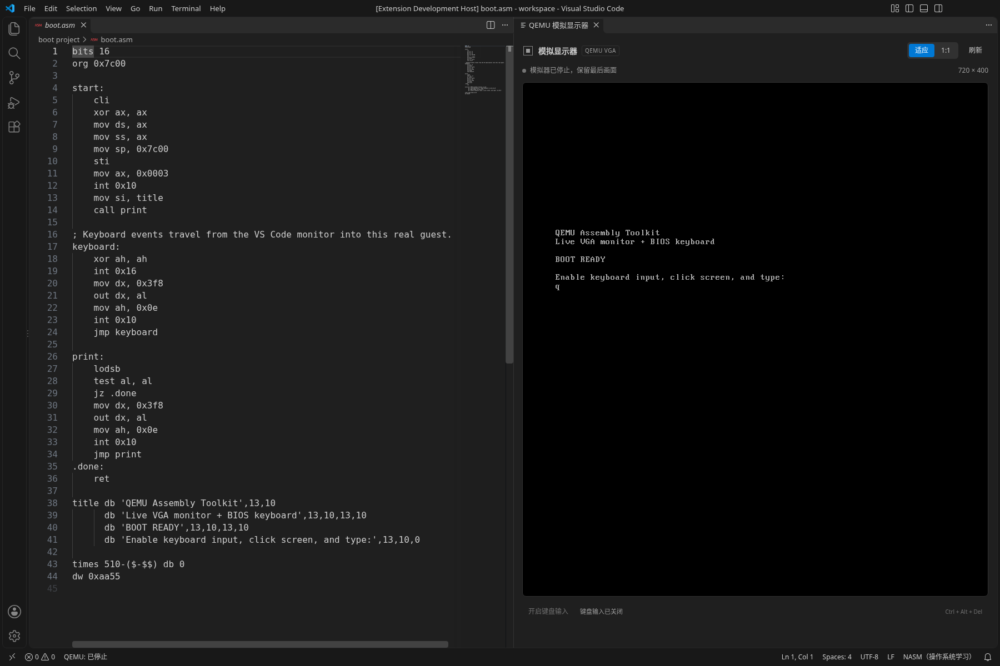
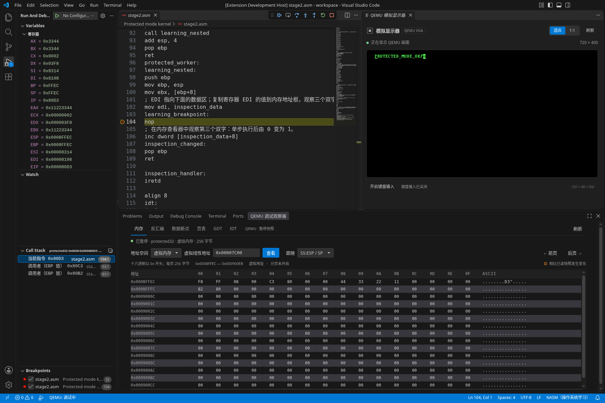
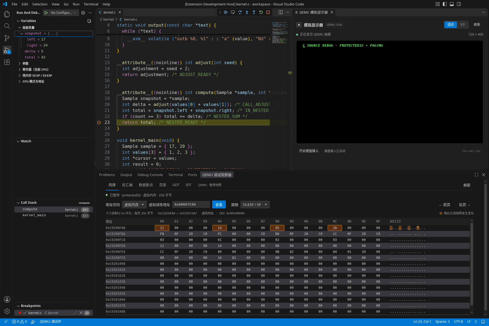
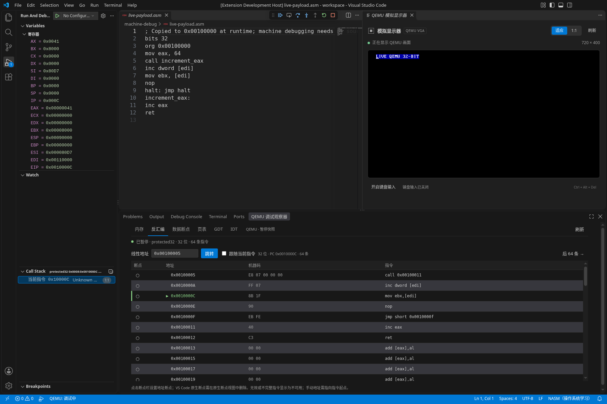
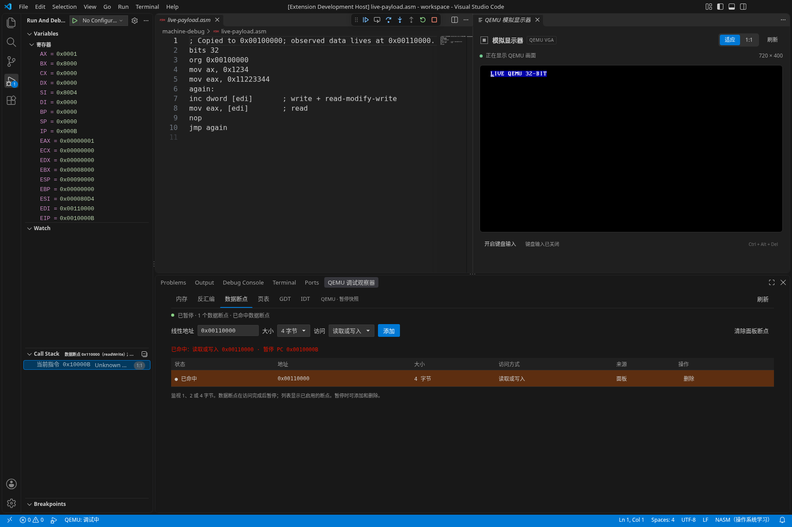
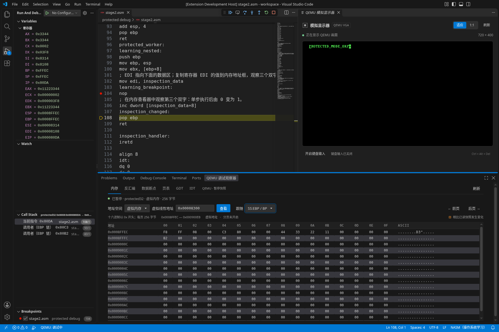
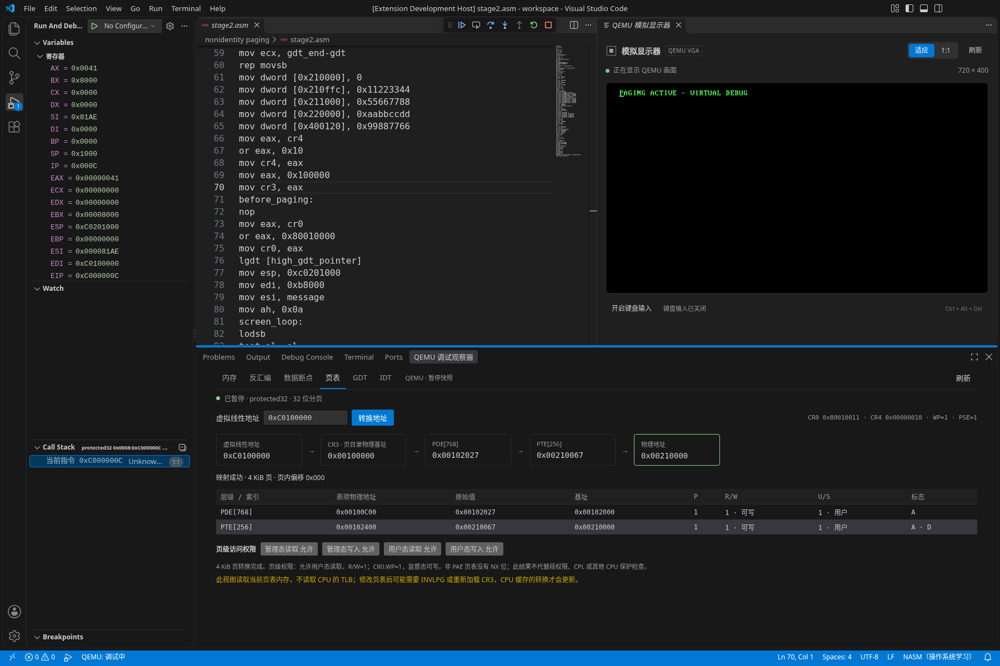
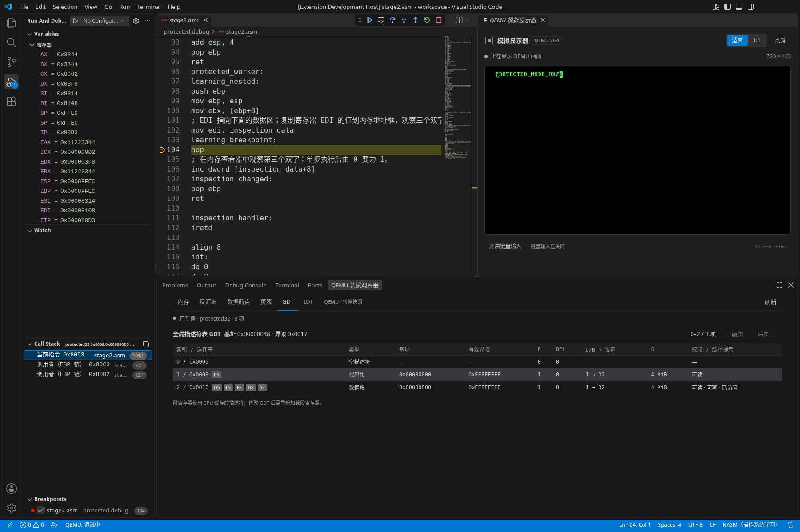

# 功能演示

共 8 段，每段约半分钟，演示一个功能。点击封面打开完整 MP4；GIF 是约 12 秒的片段预览，降低了分辨率和帧率以控制仓库体积。MP4 的文字更清晰。GitHub 未内嵌播放时，可在文件页选择下载，再用浏览器或本地播放器打开。

完整视频合计约 3 分 49 秒；视频、GIF、封面及 JSON 记录共 7.53 MiB。MP4 为 1440 × 1020、12 帧/秒；GIF 为 960 × 680、5 帧/秒，可循环播放。

| 功能 | 录屏封面（点击播放 MP4） | 观看重点与预览 |
| --- | --- | --- |
| 01 构建、运行与模拟显示器 | [](01-build-display.mp4) | **32.1 秒**。检查 NASM/QEMU、构建引导盘、运行、键盘输入和停止后保留画面。[GIF](01-build-display.gif) · [录制记录](01-build-display.json) |
| 02 汇编源码调试 | [](02-asm-debug.mp4) | **27.6 秒**。从实模式进入保护模式，观察 CR0.PE、远跳转、寄存器、栈与函数调用。[GIF](02-asm-debug.gif) · [录制记录](02-asm-debug.json) |
| 03 C 源码调试 | [](03-c-source.mp4) | **27.6 秒**。ELF/DWARF 行断点、单步进入/跳出，查看局部变量、参数和复合类型。[GIF](03-c-source.gif) · [录制记录](03-c-source.json) |
| 04 反汇编与地址断点 | [](04-disassembly.mp4) | **26.6 秒**。查看实际指令、跳到地址、设置地址断点，以及无源码代码中的 CALL 单步。[GIF](04-disassembly.gif) · [录制记录](04-disassembly.json) |
| 05 数据断点 | [](05-data-breakpoints.mp4) | **26.6 秒**。NASM 后端分别演示写入、读取、读写监视点，查看实际命中与内存变化。[GIF](05-data-breakpoints.gif) · [录制记录](05-data-breakpoints.json) |
| 06 内存观察 | [](06-memory.mp4) | **26.2 秒**。查看十六进制与 ASCII、单步后的变化高亮，以及栈指针跟随。[GIF](06-memory.gif) · [录制记录](06-memory.json) |
| 07 分页与地址转换 | [](07-paging.mp4) | **30.1 秒**。查看 CR3、PDE/PTE、权限与物理地址，对照虚拟/物理内存。[GIF](07-paging.gif) · [录制记录](07-paging.json) |
| 08 GDT、IDT 与 IVT | [](08-descriptors.mp4) | **32.6 秒**。查看段权限、选择子和中断门，重启回实模式观察 IVT 并翻页。[GIF](08-descriptors.gif) · [录制记录](08-descriptors.json) |

## 在自己的项目中打开

先安装插件、配置外部工具并信任项目所在工作区。完整项目配置见[主 README](../../README.md#配置)。

| 功能 | VS Code 入口 |
| --- | --- |
| 构建与显示器 | 命令面板依次执行 **QEMU Assembly: 检查环境**、**构建并运行**；右侧自动打开模拟显示器，键盘输入需手动开启。 |
| 汇编/C 调试 | 源码行左侧设置断点，执行 **QEMU Assembly: 开始引导调试**。F5 继续、F10 跳过、F11 进入、Shift+F11 跳出；左侧查看变量与调用堆栈。 |
| 反汇编 | 暂停后执行 **QEMU Assembly: 查看反汇编**，输入地址或跟随当前 PC，点击行首圆点设置地址断点。 |
| 数据断点 | 暂停后执行 **QEMU Assembly: 查看数据断点**，指定地址、1/2/4 字节长度和访问类型，添加后继续。 |
| 内存、GDT、IDT | 暂停后执行 **QEMU Assembly: 查看内存与描述符表**，在底部调试观察器切换页签。 |
| 页表 | 暂停后执行 **QEMU Assembly: 查看分页与地址转换**，输入虚拟线性地址；内存页可切换虚拟/物理地址空间。 |

## 录制与范围

这些演示使用 0.7 系列、Linux x64、VS Code 1.142.0 和真实 QEMU TCG 客体，无音轨。画面来自实际扩展开发宿主；中文步骤字幕位于应用画面外。录制脚本自动操作编辑器与调试界面，并核对实际调试状态；显示的寄存器、内存、调用栈和 VGA 画面来自客体。客体是录制脚本在临时目录生成的固定测试程序，不会修改已有用户工程，也不是新增的教学项目模板。

C 源码片段使用 0.7.1：录制时发现 VS Code 单步后会异步请求上一停机位置的作用域，已修复后端对过期请求的处理，并通过原生调试命令重新录制。过期作用域返回空列表；有效帧继续读取其对应的真实数据。录制覆盖 0.7.0 和 0.7.1，每段 JSON 记录实际插件版本、源码提交及动作与客体状态断言结果。

C 片段使用 GCC 生成带 DWARF 的 ELF32，并通过 GDB 调试。C/GDB 后端的写入数据断点按**值变化**暂停；写入相同值不会暂停。NASM 后端的写入断点按写访问暂停；读取、读写断点按对应访问暂停。读写命中报告不区分本次究竟是读还是写。具体支持边界见[功能说明](../../README.md#nasm-映射与通用模式范围)和[验证记录](../VALIDATION.md)。这些 Linux 录屏不代表 Windows/macOS 的原生验证。

## 重新录制

录制脚本适用于 Linux X11。需要 Xvfb、Node.js 22、VS Code、NASM、QEMU、Python 3/libX11，以及支持 libx264/libass 的 FFmpeg/ffprobe 和中文字体（如 Noto Sans CJK）；C 片段还需 GCC、GNU binutils 与 GDB。先在仓库根目录运行：

```sh
npm ci
npm run compile
```

按需通过 `VSCODE_EXECUTABLE_PATH`、`NASM_PATH`、`QEMU_PATH`、`GDB_PATH` 指定工具，C 编译工具可使用 `CC`、`LD`、`OBJCOPY`、`NM`，转码工具可使用 `FFMPEG_PATH`、`FFPROBE_PATH`。未指定 VS Code 时，脚本尝试下载稳定版。录制使用独立临时工作区和用户配置，只清理自己创建的进程。

使用独立 Xvfb 显示运行，避免录入或调整现有桌面窗口。以下为单段录制示例：

```sh
xvfb-run -a -s '-screen 0 1800x1200x24' node scripts/demos/build-display.cjs
```

将脚本名替换为 `asm-debug.cjs`、`c-source.cjs`、`disassembly.cjs`、`data-breakpoints.cjs`、`memory.cjs`、`paging.cjs` 或 `descriptors.cjs`，即可重录相应片段。输出默认写到 `docs/demos`；设置 `QEMU_ASM_DEMO_OUTPUT` 可改到其他目录。每段生成 MP4、GIF、PNG 封面及 JSON；JSON 保存录制参数、步骤时刻与客体状态断言结果。源码见 [scripts/demos](../../scripts/demos)。
